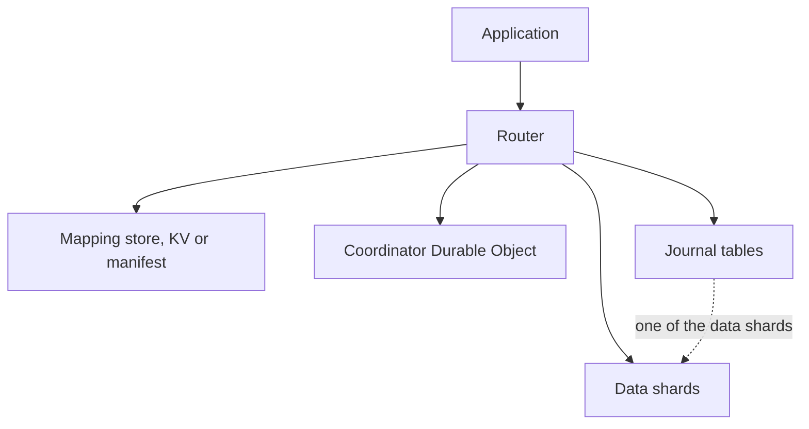
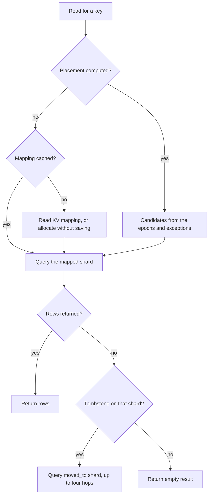

# Architecture

This page describes the parts a routed query passes through, how a read and a write move through them, and what the coordinator does. It is for anyone deciding where the coordinator, the mapping store and the journal go, or tracing a routing decision. Setting up a backend is covered in [providers](providers.md), and the public functions are listed in the [API reference](api-reference.md).

## Components

The diagram shows the parts that take part in routing. Each box is a role. A single binding can play more than one role, for example a data shard that also holds the journal.

The router is the set of functions the package exports. It holds the configuration, decides which shard owns a key, and runs the query there. Each entry in `shards` is a data shard. Any supported SQL backend can serve as one.

The mapping store records which shard owns a key. With KV placement, that is one KV entry per key. With computed placement, it is the placement manifest and a set of exceptions, and most keys have no stored entry at all.

The coordinator is an optional Durable Object. It allocates new keys and holds the state that has to be shared across isolates. Configure it with the `coordinator` binding.

The journal is a set of tables on the shard named by `journalShard`. It records each step of a move and holds the recovery lease. A deployment without moves does not need one.

## Read Path

The flowchart shows how a read reaches its rows, including the tombstone check that follows a move.

Under KV placement, the router first looks for the key's mapping in the mapper cache, then in KV. The cache keeps an entry for `mappingCacheTtlMs`, which defaults to 30000 milliseconds. A key with no mapping gets a shard from the strategy for the read, and the choice is not saved unless `allocateOnRead` is set. The read then returns whatever that shard holds, which for a new key is nothing.

Under computed placement, the router loads the manifest and the exception set, both cached for about ten seconds. A key with a recorded exception resolves through its stored mapping. Any other key resolves to the owners the epochs compute for it, newest epoch first. When the first candidate returns nothing, the router queries the next one, and a row found under an older epoch is recorded as an exception.

The tombstone check runs only when `journalShard` is set, because only moves write tombstones. A shard that holds a tombstone for the key names the shard that now holds the row. The router follows that chain for up to four hops. A lookup that fails throws unless the read passed `bestEffort`. The [shard moves](shard-moves.md) page covers the error codes.

## Write Path

A write first finds the shard that owns its key. A key with a mapping keeps that shard. A new key goes through allocation, which filters the shards in this order: `shardState`, then the `eligible` predicate, then `maxDatabaseSize`. The strategy then picks one of the shards that remain. A write saves the mapping it created, so the key stays on that shard from then on. A read of a new key does not save one.

When a coordinator is configured, the router sends the allocation to it for every strategy. The request carries the strategy name and the list of eligible shards, and the coordinator returns the shard. If the request throws, the router logs a warning and picks the shard locally. If the coordinator answers with a non-OK status, the router picks the shard locally without a warning. The insert path has the same two fallbacks, and both use the same local strategy.

Under computed placement, a write goes to the newest owner. When the key has more than one candidate, the router probes each candidate for the row first and writes to the one that has it. [Writes after a topology change](shard-moves.md#writes-after-a-topology-change) covers that probe.

With a journal, a write that changes no row checks its shard for a tombstone before it reports success. The [migration protocol](migration-protocol.md) describes the guarded statements.

## Coordinator

The coordinator is a Durable Object. Its instance is picked by `coordinatorScope`, which defaults to `'default'`, so several router sets can share one coordinator by using the same scope.

It stores the known shard names, per-shard statistics, the round-robin index, the strategy and the location settings it was given. When a coordinator is configured, it is the source of allocation decisions for every strategy. That is what makes round-robin exact across isolates: one index serves all of them. Without a coordinator, round-robin keeps its index in the isolate that serves the request.

The coordinator's allocation ledger is advisory. The KV mapping is the record. [Reconciling allocations](shard-moves.md#reconciling-allocations) compares the two.

## Allocation Strategies

Each strategy picks from the shards that accept new keys. The [sharding](sharding.md) page covers how to choose one.

- `hash` picks the eligible shard with the highest rendezvous score for the key. The result depends only on the key and the shard names.
- `round-robin` cycles through the eligible shards in order. Its counter is shared when a coordinator is configured and kept per isolate otherwise.
- `random` picks an eligible shard at random.
- `location` picks the eligible shard nearest `targetRegion`, and falls back to `hash` when no target region or no shard location is set.

## Backend Requirements

Data shards can be any SQL backend CollegeDB has an adapter for. Moves and the journal-held manifest need a proven dialect: SQLite (including D1), Postgres, or MySQL and MariaDB. A move with a shard on another dialect throws `MIGRATION_UNSUPPORTED_DIALECT`. When the journal shard is on another dialect, the KV copy of the manifest is authoritative.
