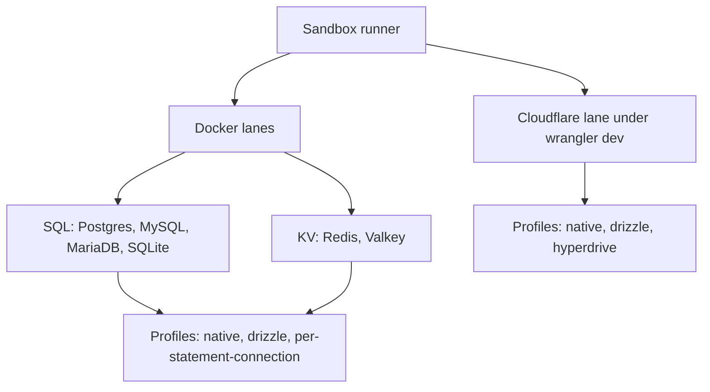
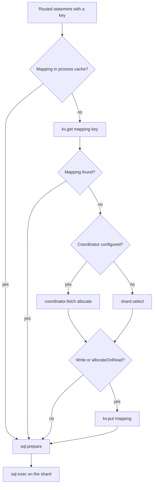

# Benchmarks

This page covers the sandbox benchmark runner: which combinations it runs, what each scenario asserts, how to read its report, and how to measure the same phases on your own deployment. It is for maintainers running the sandbox and for operators sizing a deployment.

This page does not publish measured results. A measured figure goes here with its date and the command that produced it, and nowhere else in the docs.

## Benchmark Suite

The runner, [`scripts/sandbox/run.ts`](https://github.com/earth-app/CollegeDB/blob/master/scripts/sandbox/run.ts), executes each SQL and KV combination under each adapter profile, then writes a Markdown report. The Cloudflare lane runs the sandbox worker under `wrangler dev --local`.

The layout below shows how the matrix is built. The Docker lanes cross SQL providers with KV providers and profiles. The Cloudflare lane runs its own profiles.



### Adapter Profiles

A profile selects how the runner connects to a provider.

| Profile                  | Lane                        | Purpose                                                                  |
| ------------------------ | --------------------------- | ------------------------------------------------------------------------ |
| native                   | Docker and Cloudflare       | Direct provider clients (Cloudflare bindings or driver-native adapters)  |
| drizzle                  | Docker and Cloudflare       | Drizzle interop through SQL provider adapters                            |
| hyperdrive               | Cloudflare only             | A `HYPERDRIVE` binding, supplied by `wrangler dev` from a local Postgres |
| per-statement-connection | Docker only, not for SQLite | A fresh driver connection per statement                                  |

The default profiles are `native` and `drizzle`. `per-statement-connection` is excluded from the default matrix, because it measures a connection pattern that no supported deployment uses.

The `hyperdrive` profile needs a Workers runtime. With `wrangler dev` and `localConnectionString`, Cloudflare states that Hyperdrive's connection pooling and query caching do not take effect. The hyperdrive cell therefore checks correctness and connection count, not pooling latency.

## Scenario Catalog

The runner defines 28 scenarios. The workload column gives the default run: `--iterations=20`, `--bulk-size=160`, and `--race-iterations=60`. Other iteration counts scale from these defaults.

| Key                     | What it asserts or measures                                                                                                                                                                                                                                                                                              | Default workload                                                                               |
| ----------------------- | ------------------------------------------------------------------------------------------------------------------------------------------------------------------------------------------------------------------------------------------------------------------------------------------------------------------------ | ---------------------------------------------------------------------------------------------- |
| basic_crud              | Insert, read, update and delete of a user through routed queries                                                                                                                                                                                                                                                         | 20 iterations; 4 routed SQL ops each                                                           |
| advanced_usage          | Writes a user and a post, adds lookup aliases, validates a join and alias-based lookup                                                                                                                                                                                                                                   | 15 iterations; about 5 routed SQL ops and KV lookup-key updates each                           |
| migration_mapping       | Inserts legacy records on one shard, builds shard mappings in a batch, validates routing                                                                                                                                                                                                                                 | 10 iterations; 20 legacy records mapped each                                                   |
| bulk_crud               | Bulk inserts, half updates, a full delete sweep, and shard-wide totals                                                                                                                                                                                                                                                   | 7 iterations; 160 inserts, 80 updates and 160 deletes each                                     |
| auto_increment          | Generated primary keys. Docker lanes insert with `insertShard` and read the captured key back. Cloudflare lanes allocate with `nextId`, read back, then expect `GENERATED_KEY_COLLISION` when one id reaches two shards                                                                                                  | 9 iterations; Cloudflare adds a refusal arm                                                    |
| indexing                | Queries the indexed path after an index on `posts(user_id)`                                                                                                                                                                                                                                                              | 15 iterations after a warmup dataset                                                           |
| metadata_fetch          | Reads table metadata rows from one shard                                                                                                                                                                                                                                                                                 | 30 iterations; 1 query each                                                                    |
| pragma_or_info          | Runs the provider-specific PRAGMA or info query                                                                                                                                                                                                                                                                          | 30 iterations; 1 query each                                                                    |
| counting                | Counts users across all shards                                                                                                                                                                                                                                                                                           | 30 iterations; 1 all-shard count each                                                          |
| shard_fanout            | Runs a query on every shard and aggregates the responses                                                                                                                                                                                                                                                                 | 30 iterations; 1 all-shard query each                                                          |
| reassignment            | Creates a record, reassigns it to another shard, verifies routed reads                                                                                                                                                                                                                                                   | 10 iterations                                                                                  |
| mapping_miss            | Reads a key that was never written                                                                                                                                                                                                                                                                                       | 20 iterations; 1 routed read each                                                              |
| next_id                 | Allocates a cluster-unique id with `nextId`                                                                                                                                                                                                                                                                              | 20 iterations; 1 allocation each                                                               |
| paginate                | One sorted page across all shards, with the per-shard limit pushed down                                                                                                                                                                                                                                                  | 30 iterations after a warmup dataset                                                           |
| batch_write             | Routed statements grouped into one round trip per shard                                                                                                                                                                                                                                                                  | 7 iterations; 160 statements each                                                              |
| cold_mapping_cache      | Reads an existing key with the in-memory mapping cache disabled                                                                                                                                                                                                                                                          | 20 iterations; 1 routed read each                                                              |
| concurrent_load         | Routed reads issued concurrently instead of one at a time                                                                                                                                                                                                                                                                | 20 iterations; 16 concurrent reads each                                                        |
| journal_move            | Moves a key through the journal, then runs tombstone-checked writes and a stale-route refusal                                                                                                                                                                                                                            | 10 iterations                                                                                  |
| stale_route_write       | Races update, delete, insert and upsert writers against a cutover. Every acknowledged write must sit on the owner shard, with no ghost row. A control arm without the key lock must report violations                                                                                                                    | `--race-iterations` per write kind; Postgres, MySQL and MariaDB                                |
| kv_bulk_read            | `getMany` over 100 keys, a tenth of them absent, checked against 100 single gets                                                                                                                                                                                                                                         | 20 iterations; 1 `getMany` each                                                                |
| batch_rollback          | A batch whose third statement repeats a primary key; the first two must roll back                                                                                                                                                                                                                                        | 10 iterations; 1 failing 3-statement batch each                                                |
| topology_cas            | Compare-and-swap races on the manifest, a stale-generation writer against the fence, and `pruneEpochs` on three shards. Control arms must report violations                                                                                                                                                              | `--race-iterations` per race kind                                                              |
| missing_sidecar_lookup  | A journaled read on a shard without sidecar tables answers not found and issues no DDL. A broken lookup throws `MIGRATION_LOOKUP_UNAVAILABLE`, or answers not found with `bestEffort`                                                                                                                                    | A few reads per arm                                                                            |
| reconcile_record_probe  | `reconcileAllocations` against live shards: verified, missing, and unchecked rows, and a run without `verifyRecords` issues no SQL                                                                                                                                                                                       | 9 runs per engine and adapter; 6 ledger keys over 3 shards                                     |
| recovery_lease_takeover | Lease expiry and takeover during a move. A fenced recovery throws `RECOVERY_FENCED` and writes nothing. Overlapping recoveries leave one winner and `RECOVERY_IN_PROGRESS` for the rest                                                                                                                                  | About a quarter of `--race-iterations` per arm; 3 protocol and 3 control arms                  |
| history_index_ensure    | `ensureJournalSchema` adds the history index to journal tables created without it. Concurrent ensures leave one index behind                                                                                                                                                                                             | 2 sequential ensures and about a quarter of `--race-iterations` rounds of 4 concurrent ensures |
| als_overlap             | Overlapping `collegedb` calls with different shard sets on local workerd with `nodejs_compat`. Cloudflare lane only                                                                                                                                                                                                      | 200 overlapping pairs per arm                                                                  |
| als_no_compat           | The same overlap without `nodejs_compat`. A callback with a different configuration is refused with `CONCURRENT_CONFIG`. Cloudflare lane only. Can fail on constrained runners because of an upstream `wrangler dev` proxy race ([cloudflare/workers-sdk#16348](https://github.com/cloudflare/workers-sdk/issues/16348)) | 200 iterations                                                                                 |

`als_no_compat` can fail on constrained runners because of an upstream `wrangler dev` proxy race ([cloudflare/workers-sdk#16348](https://github.com/cloudflare/workers-sdk/issues/16348)), so a failure there does not by itself show a library regression.

Scenarios marked as the Cloudflare lane only, and the race scenarios that need a second connection, are reported as `N/A` with a reason in the lanes that do not run them. Local D1 is one SQLite file behind workerd, so the race scenarios that need two connections have no Cloudflare arm.

### Runner Options

| Flag                     | Default | Effect                                                                                             |
| ------------------------ | ------- | -------------------------------------------------------------------------------------------------- |
| `--db=`                  | all     | `postgres`, `mysql`, `mariadb`, or `sqlite`. `postgresql` is accepted as an alias.                 |
| `--kv=`                  | all     | `redis` or `valkey`                                                                                |
| `--profile=`             | all     | `native`, `drizzle`, `per-statement-connection`, or `hyperdrive`. `all` runs the default profiles. |
| `--iterations=`          | 20      | Base iteration count. Other scenario counts scale from it.                                         |
| `--bulk-size=`           | 160     | Routed operations per bulk iteration. Minimum 10.                                                  |
| `--strategy-statements=` | 100     | Statements per strategy-matrix run. Minimum 10.                                                    |
| `--race-iterations=`     | 60      | Iterations per race kind. Minimum 2.                                                               |
| `--only=`                | none    | Comma-separated scenario keys. Runs only these and skips the strategy matrix.                      |
| `--include-cloudflare`   | off     | Adds the Cloudflare lane.                                                                          |
| `--cloudflare-only`      | off     | Runs only the Cloudflare lane. Implies `--include-cloudflare`.                                     |

The runner has no `--help` flag. The options above come from `scripts/sandbox/run.ts`.

### Common Commands

The Docker lanes need Docker with the Compose plugin, plus Bun. The Cloudflare lane runs through `wrangler`, which the project installs as a dev dependency.

```bash
bun run test:sandbox
bun run test:sandbox:all
bun run test:sandbox:cloudflare
bun run test:sandbox:drizzle
bun run test:sandbox:per-statement-connection
bun run test:sandbox:hyperdrive
bun run test:sandbox:postgres+redis
```

`test:sandbox` runs every SQL and KV combination under the default profiles, plus the Cloudflare lane. `test:sandbox:all` skips the Cloudflare lane. Pairwise scripts such as `test:sandbox:postgres+redis` are listed in `package.json`.

## Reading the Report

Every run writes a timestamped Markdown report to `sandbox/results/` and updates `sandbox/results/latest.md` to the newest report.

The report contains these matrices:

- `Matrix: SQL x KV (Overall)`
- `Matrix: Where a Routed Operation Spends Its Time`
- `Matrix: Adapter Profiles (Overall Avg)`
- `Matrix: Core Scenario Latency (avg/p95)`
- `Matrix: Introspection and Routing Latency (avg/p95)`
- `Matrix: Strategy Key Distribution (imbalance / chi-square)`
- `Cloudflare Worker (wrangler dev --local)`
- `Matrix: Cloudflare Adapter Profiles (Overall Avg)`

Latency cells show `avg / p95` in milliseconds. `FAILED` means the scenario returned an error. `N/A` means the scenario did not run in that environment, and the report gives the reason where one applies. The per-scenario detail list adds `p50`, `min`, `max`, and the sample count `n`.

A combination's status is `PASSED` when every scenario passed, `PARTIAL_PASSED` when at least 66% passed, and `FAILED` below that.

Two averages appear in the matrices:

- `Per-Op Avg` divides each scenario by the routed operations it performs, so scenarios with different workloads can be compared. Use it to compare backends.
- `Overall Avg` is the unweighted mean of the scenario averages. `bulk_crud` dominates it, so it is not a ranking of backends.

## Measuring Your Own Deployment

Attach a `PhaseCollector` to see the same breakdown for your own traffic. `onPhase` is off unless set, and when unset it records nothing.

```ts
import { PhaseCollector, initialize } from '@earth-app/collegedb';

const phases = new PhaseCollector();

initialize({
	kv: env.KV,
	shards: { 'db-east': env.DB_EAST, 'db-west': env.DB_WEST },
	strategy: 'hash',
	onPhase: phases.observer
});

// ... run some queries, then read the breakdown
console.table(phases.stats());
```

`PhaseStats` reports `count`, `totalMs`, `avgMs`, `minMs`, `maxMs`, `p50Ms`, and `p95Ms` for each phase. Timings use `performance.now()` where it exists, so sub-millisecond phases are visible.

The phases are:

- `kv.get`, `kv.put`, `kv.delete`, `kv.list`: one span per KV call. The detail is the key prefix.
- `shard.select`: choosing a shard with the placement strategy. The detail is the strategy name.
- `coordinator.fetch`: a call to the Durable Object coordinator.
- `sql.prepare` and `sql.exec`: preparing and running SQL on a shard. The detail is the shard binding.

The `hash` name exists in the type, but the router never emits it. The hash for the placement decision is timed inside `shard.select`, and the hash of a mapping key is not timed separately.

For a stream instead of a summary, pass a function:

```ts
initialize({
	kv: env.KV,
	shards: { 'db-east': env.DB_EAST },
	onPhase: (span) => {
		if (span.durationMs > 50) {
			console.warn(`slow ${span.phase} on ${span.detail}: ${span.durationMs.toFixed(1)}ms`);
		}
	}
});
```

An observer that throws is ignored, so a broken observer does not fail the query it measures.

### Where Time Goes in a Routed Operation

The flowchart shows the phases a routed statement passes through, in order. Each box names the phase that times it.



A key that already has a mapping skips the allocation branch. A read of a key with no mapping allocates a shard but does not store the mapping, unless `allocateOnRead` is set.

## What Costs What

This table counts the KV calls and SQL round trips on the mapping path, for one routed operation.

| Path                       | KV reads | KV writes | SQL round trips |
| -------------------------- | -------- | --------- | --------------- |
| Mapping in process cache   | 0        | 0         | 1               |
| Cold cache, mapping exists | 1        | 0         | 1               |
| Key not yet mapped, write  | 1        | 1         | 1               |
| Key not yet mapped, read   | 1        | 0         | 1               |

A read that finds no row does not write a mapping. Set `allocateOnRead: true` to store a mapping on reads as well.

## Platform Limits

These are Cloudflare's published limits. CollegeDB does not control them, but they shape what a deployment can do.

- [Workers KV](https://developers.cloudflare.com/kv/platform/limits/) allows 1,000 writes per day to different keys on the free plan. Writes to the same key are limited to one per second. Each new primary key costs one KV write, so a free-plan deployment has a daily budget for new keys.
- [D1](https://developers.cloudflare.com/d1/platform/limits/) allows 1,000 queries per Worker invocation on the Workers Paid plan and 50 on the Free plan. A `batch()` call counts as one query, so use it for bulk writes.
- [Smart Placement](https://developers.cloudflare.com/workers/configuration/smart-placement/) runs the Worker near its back-end service. Cloudflare states that reducing per-query round-trip latency from 20 to 30 milliseconds to 1 to 3 milliseconds improves response times.

## Fault Tolerance

A single database is a single point of failure. With N shards and an even key distribution, losing one shard affects about 1/N of the keys. When a routed read through `firstResilient` finds no row, it runs a cross-shard scan before it returns `null`.

## When to Use CollegeDB

Use CollegeDB when:

- The dataset approaches the size or throughput limit of one database.
- Write throughput exceeds what one database instance sustains.
- Data needs to sit in particular regions.
- A failure should affect a fraction of the dataset instead of all of it.

Avoid it when:

- One database serves the dataset without strain.
- The workload runs mostly cross-shard queries, which fan out to every shard.
- The primary key is a database-generated sequence that must span shards, unless ids come from `nextId()`.
