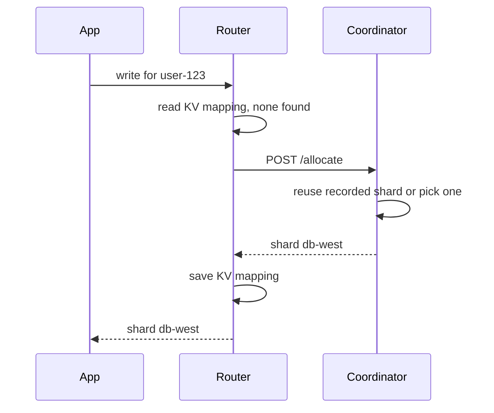
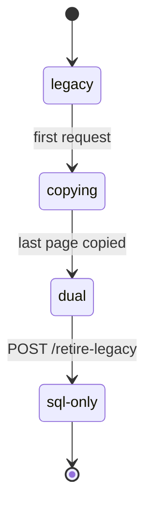

# Coordinator

This page covers the ShardCoordinator Durable Object: how to bind it, the HTTP endpoints and methods it exposes, the storage upgrade from 1.3.x, and what the router does when the coordinator fails. It is for deployers who bind the coordinator and for anyone upgrading from 1.3.x. The coordinator runs only on Cloudflare Workers, and it is optional. Without it, the router allocates each new key with the local strategy.

## When to Use It

The coordinator makes allocation decisions for its scope, so round-robin uses one counter across every isolate. It also keeps the shard list and the per-shard statistics in one place. [Architecture](architecture.md) shows where it sits in the routing path. Sequence values for generated ids are served by the coordinator when one is configured, see [Generated ids](generated-ids.md).

## Setup

Declare the class in `wrangler.jsonc`. The coordinator keeps its state in the object's SQLite database (`ctx.storage.sql`), so the class goes under `new_sqlite_classes`.

```jsonc
{
	"durable_objects": {
		"bindings": [
			{
				"name": "ShardCoordinator",
				"class_name": "ShardCoordinator"
			}
		]
	},
	"migrations": [
		{
			"tag": "v1",
			"new_sqlite_classes": ["ShardCoordinator"]
		}
	]
}
```

The Worker exports the class and passes the binding as `coordinator`. Set `coordinatorScope` to split keys across coordinator objects. The scope is the name passed to `idFromName`, and it defaults to `'default'`. A change of scope starts from an empty allocation ledger.

```ts
import { collegedb, createWorkersKVProvider, ShardCoordinator } from '@earth-app/collegedb';

export { ShardCoordinator };

export default {
	async fetch(request: Request, env: Env): Promise<Response> {
		return await collegedb(
			{
				kv: createWorkersKVProvider(env.KV),
				coordinator: env.ShardCoordinator,
				coordinatorScope: 'default',
				strategy: 'round-robin',
				shards: {
					'db-east': env['db-east'],
					'db-west': env['db-west']
				}
			},
			async () => {
				// application logic here
				return new Response('ok');
			}
		);
	}
};
```

The `Env` type is the one from [Cloudflare](cloudflare.md).

## HTTP Endpoints

Send requests with `coordinator.fetch`. The router reads only the method and the path, so the host in the URL does not matter. The examples use `http://coordinator`.

```ts
const coordinator = env.ShardCoordinator.get(env.ShardCoordinator.idFromName('default'));
const response = await coordinator.fetch('http://coordinator/allocate', {
	method: 'POST',
	headers: { 'Content-Type': 'application/json' },
	body: JSON.stringify({ primaryKey: 'user-123', strategy: 'hash' })
});
const { shard } = await response.json();
```

| Endpoint             | Method | Request body                                              | Response                                                                                                         |
| -------------------- | ------ | --------------------------------------------------------- | ---------------------------------------------------------------------------------------------------------------- |
| `/shards`            | GET    | None                                                      | `["db-east", "db-west"]`                                                                                         |
| `/shards`            | POST   | `{"shard": "db-new"}`                                     | `{"success": true}`. Idempotent for a known shard.                                                               |
| `/shards`            | DELETE | `{"shard": "db-old"}`                                     | `{"success": true}`                                                                                              |
| `/stats`             | GET    | None                                                      | `[{"binding": "db-east", "count": 1542, "lastUpdated": 1672531200000}]`                                          |
| `/stats`             | POST   | `{"shard": "db-east", "count": 1600}`                     | `{"success": true}`. An unregistered shard is ignored.                                                           |
| `/allocate`          | POST   | `{"primaryKey": "user-123", "strategy": "hash"}`          | `{"shard": "db-west"}`. Adds `"reused": true` when the key already has an eligible recorded shard.               |
| `/forget`            | POST   | `{"primaryKey": "user-123"}`                              | `{"success": true}`                                                                                              |
| `/sequence`          | POST   | `{"name": "tickets", "min": 42}`                          | `{"value": 42}`. The value is the larger of the stored counter plus one and `min`.                               |
| `/sequence`          | POST   | Same, with `"requireExisting": true`                      | `{"needsSeed": true}` when the sequence has no stored value yet                                                  |
| `/allocations`       | GET    | None. Query: `after`, `limit` (default 100, maximum 1000) | `{"allocations": [{"primaryKey": "user-123", "shard": "db-west", "createdAt": 1729800000}], "next": "user-123"}` |
| `/allocations/prune` | POST   | `{"primaryKeys": ["user-123"]}`, at most 128 keys         | `{"pruned": 1}`                                                                                                  |
| `/retire-legacy`     | POST   | None                                                      | `{"success": true}`. See the upgrade section below.                                                              |
| `/flush`             | POST   | None                                                      | `{"success": true}`. Clears all state. Development only.                                                         |
| `/health`            | GET    | None                                                      | `OK`, as plain text                                                                                              |

`next` is the last key of a page when more rows follow, and `null` on the last page. `/allocations` and `/allocations/prune` finish any pending storage upgrade before they answer.

Routes match on the method and the path together, so an unknown path and a known path with the wrong method both return `404` with the plain-text body `Not Found`. There is no `405`. A handler that throws returns `500` with the plain-text body `Internal Server Error`. That includes a body that is not valid JSON, since the handlers parse it without a guard.

`400` with a JSON `error` field covers a missing or invalid required field and nothing else:

1. `shard` on `POST /shards`, `DELETE /shards` and `POST /stats`.
2. `count` on `POST /stats`.
3. `primaryKey` on `POST /allocate` and `POST /forget`.
4. `name` on `POST /sequence`.
5. `primaryKeys` on `POST /allocations/prune`.
6. `POST /allocate` when no shard is eligible (`No shards available`).

`GET /allocations` never returns `400`. A `limit` that is not a number falls back to 100, and other values are clamped to 1 through 1000. A `strategy` value the coordinator does not recognize returns `200` with a hash pick, not `400`.

Read a non-OK body as text, since the body is JSON only for the `400` case.

## Programmatic Methods

The methods below are called on the stub from `env.ShardCoordinator.get(...)`. The runtime constructs the class from the Durable Object state, so application code does not construct it.

| Method                       | Returns             | Notes                                                                           |
| ---------------------------- | ------------------- | ------------------------------------------------------------------------------- |
| `fetch(request)`             | `Promise<Response>` | Handles the endpoints above                                                     |
| `incrementShardCount(shard)` | `Promise<void>`     | Adds one to the count of a registered shard. Does nothing for an unknown shard. |
| `decrementShardCount(shard)` | `Promise<void>`     | Subtracts one, never below zero. Does nothing for an unknown shard.             |
| `forgetAllocation(key)`      | `Promise<void>`     | Drops the recorded allocation for a key. Since 1.3.0.                           |
| `retireLegacy()`             | `Promise<void>`     | Finishes the storage upgrade and deletes the legacy keys. Since 1.4.0.          |

The router never calls `incrementShardCount` or `decrementShardCount`. Your code calls them when keys are added or removed, and the counts from [Shard statistics](cloudflare.md) are only as current as those calls.

```ts
const coordinator = env.ShardCoordinator.get(env.ShardCoordinator.idFromName('default'));

await coordinator.incrementShardCount('db-east');
await coordinator.decrementShardCount('db-west');
```

## Reconciling Allocations

`reconcileAllocations` compares the ledger with the routing that the KV mappings and the placement give each key. It runs against the same `coordinatorScope` as the router. Its options are `limit`, `verifyRecords` (the tables and key columns to probe on each routed shard), `repair`, which requires `verifyRecords`, and `pruneVerified`. Nothing is written unless `repair` or `pruneVerified` is set. [Shard moves](shard-moves.md) defines each count in the report and the reasons a routed row is not proof of ownership.

## How Allocation Works

The diagram shows a write for a key with no KV mapping. The router asks the coordinator for a shard, saves the mapping, and then uses the shard.



A key with a KV mapping resolves in the router and never reaches the coordinator. A read of a key with no mapping also asks for an allocation. The router saves that result only when the `allocateOnRead` option is set. The coordinator records every decision in its ledger, including a read's decision. The KV mapping stays the record, and the ledger is advisory.

Requests to one coordinator object run one at a time, and each handler finishes before the next starts. Two first touches of the same key therefore cannot both see it unallocated.

## Failure Handling

When a coordinator is configured, the router asks it for every new key. If the request throws, the router logs a warning and picks the shard with the local strategy. If the coordinator answers with a non-OK status, the router picks locally without logging. The local pick uses the same strategy the coordinator received. Round-robin uses the router's per-isolate counter, and the coordinator's counter does not advance for those keys.

A coordinator failure does not stop allocation, so it does not show up as an error in the request. Watch the `/health` endpoint separately. The [Cloudflare](cloudflare.md) page has a health-check recipe that does this.

## Upgrading From 1.3.x

Objects written by 1.3.x keep their state under legacy storage keys. The current version copies that state into SQL on the first requests and does not need a separate migration step. The object moves through four phases.



A new object starts in `legacy` as well and moves through the same phases on its first requests. Each request that goes through the object advances the copy by one step. The first step copies the shard list, the statistics and the sequence counters. Each later step copies up to 200 allocation rows. Reads of keys not yet copied fall back to the legacy keys while the copy runs.

While the object is in `dual`, every write lands in SQL and on the legacy keys, so a rollback to 1.3.x keeps the object readable. Writes the older version makes to the legacy keys are not copied back, and the newer version overwrites them when the object upgrades again.

`POST /retire-legacy` finishes any pending copy and then deletes the legacy keys. It can be called from any phase. Call it once no Worker running 1.3.x is still serving traffic. A deployment that never ran 1.3.x can call it right away, which stops the legacy writes. After the call, 1.3.x cannot read the object, and downgrading past it is not supported.

```ts
const coordinator = env.ShardCoordinator.get(env.ShardCoordinator.idFromName('default'));
await coordinator.fetch('http://coordinator/retire-legacy', { method: 'POST' });
```
