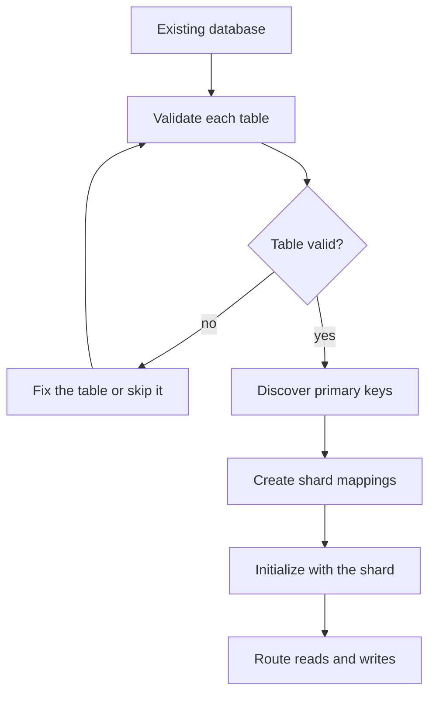

# Drop-in Replacement for Existing Databases

This page covers adding CollegeDB in front of SQL databases that already hold data: the requirements, the checks to run before integration, the integration calls, and the errors most often seen. It is for developers who have live tables with primary keys and want to route them through CollegeDB without rewriting the rows.

Existing databases join the router as shards. Integration records a mapping for each existing key, and the shard then serves that key like any other. [Getting Started](getting-started.md) covers the setup for new data.

## Requirements

1. Every table has a primary key column. The default name is `id`. Other names are passed to each call.
2. Column values have a portable form. A shard move refuses a row whose value has no portable encoding, such as a JSON object or a `Date` returned by the driver. The [Migration Protocol](migration-protocol.md) lists the rule.
3. The Worker's bindings can read and write each shard. Integration writes the mappings and, unless `addShardMappingsTable` is `false`, a `shard_mappings` metadata table.
4. A KV namespace holds the shard mappings.

The examples below wrap a D1 binding named `ExistingDB` with `toProvider`. Other shards are wrapped the same way, or use the adapters in [Providers](providers.md).

```ts
import { toProvider } from '@earth-app/collegedb';

const existing = toProvider(env.ExistingDB);
if (!existing) throw new Error('ExistingDB is not a supported binding');
```

## Integration Steps

Integration runs in three stages: validate each table, discover its keys, and integrate the database as a shard. The calls below follow that order. `integrateExistingDatabase` performs the last two stages in one call, so the separate calls are for inspection.



## Validate Tables

`validateTableForSharding` takes the primary key column name. It returns a `ValidationResult` with `isValid`, `recordCount` and `issues`. Table problems are reported in `issues`.

```ts
import { listTables, validateTableForSharding } from '@earth-app/collegedb';

for (const table of await listTables(existing)) {
	const validation = await validateTableForSharding(existing, table, 'id');
	if (validation.isValid) {
		console.log(`${table}: ${validation.recordCount} records ready`);
	} else {
		console.log(`${table}: ${validation.issues.join(', ')}`);
	}
}
```

## Discover Primary Keys

`discoverExistingPrimaryKeys` returns the key values of one table. The primary key column defaults to `id`.

```ts
import { discoverExistingPrimaryKeys } from '@earth-app/collegedb';

const userIds = await discoverExistingPrimaryKeys(existing, 'users');
console.log(`Found ${userIds.length} existing users`);

const orderIds = await discoverExistingPrimaryKeys(existing, 'orders', 'order_id');
```

## Integrate a Database

`integrateExistingDatabase` validates the tables, creates a mapping for each key, and adds the `shard_mappings` metadata table. Its options are:

- `tables`: the tables to integrate. Omit it to take every table except `shard_mappings` and tables with the `collegedb_` prefix.
- `primaryKeyColumn`: the key column for every table. Defaults to `id`.
- `addShardMappingsTable`: whether to create the metadata table. Defaults to `true`.
- `dryRun`: when `true`, the call reports what it would do and writes nothing. Defaults to `false`.
- `concurrency`: the number of operations, such as KV mapping writes, that run at once. Defaults to `25`.

```ts
import { integrateExistingDatabase, KVShardMapper } from '@earth-app/collegedb';

const mapper = new KVShardMapper(env.KV);

const result = await integrateExistingDatabase(existing, 'db-primary', mapper, {
	tables: ['users', 'posts', 'orders'],
	primaryKeyColumn: 'id',
	addShardMappingsTable: true,
	dryRun: false
});

if (result.success) {
	console.log(`Integrated ${result.totalRecords} records from ${result.tablesProcessed} tables`);
}
if (result.issues.length > 0) {
	console.error('Integration issues:', result.issues);
}
```

`success` is `true` when no issues were recorded, and also when at least one table was processed. Check `issues` even when `success` is `true`. The result also reports `shardName` and `mappingsCreated`.

A dry run reports counts without writing:

```ts
const preview = await integrateExistingDatabase(existing, 'db-test', mapper, { dryRun: true });
console.log(`Would process ${preview.totalRecords} records from ${preview.tablesProcessed} tables`);
```

To integrate only some tables, list them in `tables`. A call processes only the tables it lists.

## Initialize With Existing Shards

After integration, initialize CollegeDB with the existing databases as shards. `initializeFromEnv` finds bindings whose names start with `DB_`, `DB-` or `db-`, and it names each shard from its binding. `DB_USERS` becomes `db-users`. Use it when every database is bound in `env`:

```ts
import { first, initializeFromEnv, isInitialized, run } from '@earth-app/collegedb';

export default {
	async fetch(request: Request, env: Env): Promise<Response> {
		if (!isInitialized()) {
			initializeFromEnv(env, { strategy: 'hash' });
		}

		const existingUser = await first<{ id: string; name: string }>('user-from-old-db', 'SELECT * FROM users WHERE id = ?', [
			'user-from-old-db'
		]);

		await run('new-user-123', 'INSERT INTO users (id, name, email) VALUES (?, ?, ?)', ['new-user-123', 'New User', 'new@example.com']);

		return Response.json({ existingUser });
	}
};
```

`first` resolves to the row, or `null` when no row matches. It does not return a result object, so read the fields of the row directly.

Use `initialize` instead when the shard map is built in code. Pass each database as a shard, using the same wrapping as above.

Detection runs in the background after `initialize`. `initializeAsync()` waits for it instead, at the cost of that wait on the call that makes it. It suits a script or a deploy step.

## Reset Detection and Mappings

Two calls undo parts of the setup. Neither one restores rows.

- `clearMigrationCache()` clears the in-memory migration status cache, so the next migration check reads each shard again.
- `new KVShardMapper(env.KV).clearAllMappings()` deletes every shard mapping in KV, including mappings written after integration. Keys then route as new keys and can land on different shards. The method is for development and test resets.

```ts
import { clearMigrationCache, KVShardMapper } from '@earth-app/collegedb';

clearMigrationCache();

const mapper = new KVShardMapper(env.KV);
await mapper.clearAllMappings();
```

## Troubleshooting

### Tables Without Primary Keys

`validateTableForSharding` reports this in `issues`:

```text
Primary key column 'id' not found or not set as primary key
```

SQLite cannot add a primary key column to an existing table with `ALTER TABLE ... ADD COLUMN`, so the table has to be rebuilt. The steps below use `legacy_key` as a column that is unique for every row. Choose the column your data already uses as a stable identifier, and do not generate new values for existing rows, since other systems may refer to them.

```sql
CREATE TABLE legacy_table_new (id TEXT PRIMARY KEY, name TEXT, created_at INTEGER);
INSERT INTO legacy_table_new (id, name, created_at) SELECT legacy_key, name, created_at FROM legacy_table;
DROP TABLE legacy_table;
ALTER TABLE legacy_table_new RENAME TO legacy_table;
```

Run the steps against a copy of the database first, and compare row counts before dropping the original.

### Large Database Integration

Integrate a large database in groups of tables, so each call stays small:

```ts
const allTables = await listTables(existing);
const batchSize = 10;

for (let i = 0; i < allTables.length; i += batchSize) {
	const batch = allTables.slice(i, i + batchSize);
	await integrateExistingDatabase(existing, 'db-large', mapper, {
		tables: batch
	});
}
```

### Mixed Primary Key Types

When each table uses a different key column, discover the keys per table and create the mappings with `createMappingsForExistingKeys`. Its arguments are the keys, the shard names, the placement strategy, and the mapper.

```ts
import { createMappingsForExistingKeys, discoverExistingPrimaryKeys } from '@earth-app/collegedb';

const customIntegration = {
	users: 'user_id',
	orders: 'order_number',
	products: 'sku'
};

for (const [table, pkColumn] of Object.entries(customIntegration)) {
	const keys = await discoverExistingPrimaryKeys(existing, table, pkColumn);
	await createMappingsForExistingKeys(keys, ['db-shard1'], 'hash', mapper);
}
```
