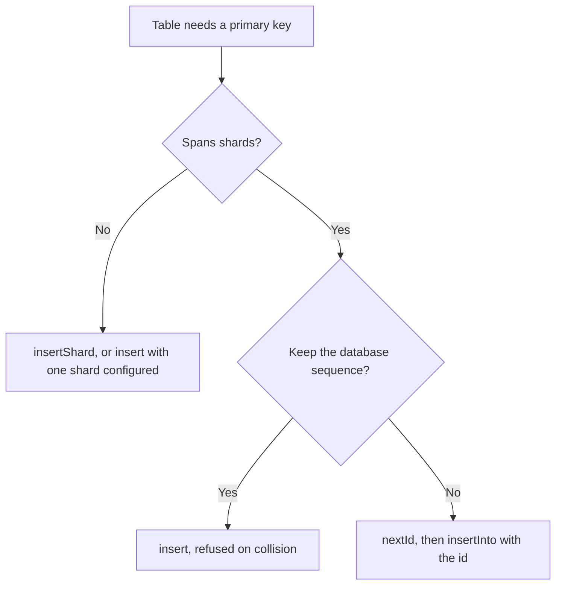
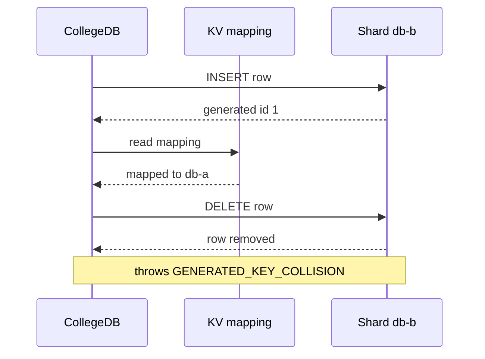

# Generated Ids

This page covers primary keys that the database assigns on insert, and how CollegeDB routes those rows. It is for developers who insert into a table whose key comes from an AUTOINCREMENT, SERIAL or identity column, and for anyone choosing between `insert()`, `insertShard()` and `nextId()`.

## Why Database-Generated Ids Collide

A database-generated id is only unique within its own shard. Each shard runs its own AUTOINCREMENT or SERIAL sequence, so `db-a` and `db-b` both hand out 1, then 2, then 3. A table spread across shards eventually receives the same id twice. The second mapping would overwrite the first, and the earlier row would sit on a shard that no key routes to.

CollegeDB refuses the second insert with `GENERATED_KEY_COLLISION`. The section on collisions below covers what happens to the row that the refused INSERT wrote.

## Insert Helpers

`insert()` runs the statement on the shard the router allocates for a new key. `insertShard()` runs it on the shard you name. Both run the INSERT, read the generated id, and store the id-to-shard mapping, so `first()` and `all()` find the row through the routed read path.

Both return the write result with a `generatedId` field.

```ts
import { first, insertShard } from '@earth-app/collegedb';

const created = await insertShard('db-east', 'INSERT INTO audit_log (action, at) VALUES (?, ?)', ['login', Date.now()]);
const row = await first(String(created.generatedId), 'SELECT * FROM audit_log WHERE id = ?', [created.generatedId]);
```

## Reading the Id from the Statement

CollegeDB reads the generated id from the statement's `RETURNING` row when the SQL contains `RETURNING`. Otherwise it reads the driver's last-insert metadata. Specifically:

- If the statement returns a row, CollegeDB reads `id` or `rowid` from that row, ignoring letter case, along with a few driver aliases such as `lastInsertId`. It does not fall back to driver metadata.
- If the statement returns no row, CollegeDB reads the driver's last-insert id.
- If neither yields an id, the call throws `GENERATED_KEY_UNAVAILABLE`.

Include `RETURNING` in the statement when the primary key is not named `id` or `rowid`. Pass `idColumn` to name the key column:

```ts
import { insert } from '@earth-app/collegedb';

const created = await insert('INSERT INTO things (uuid, label) VALUES (?, ?) RETURNING uuid, label', ['abc', 'Widget'], {
	idColumn: 'uuid'
});

console.log(created.generatedId); // 'abc'
```

With `idColumn` set, CollegeDB reads only that column from the returned row. A missing value throws `GENERATED_KEY_UNAVAILABLE`. The helper does not fall back to the first column or to the rowid. On a `TEXT PRIMARY KEY` table the rowid is a different value from the key, so routing on it places the row where no reader looks.

Without `RETURNING`, `idColumn` has no effect, and the driver's last-insert id is used.

## Examples by Dialect

The example below assumes `db-east` is the only shard. It uses SQLite syntax, which D1 also accepts.

```ts
import { createSchema, first, insert } from '@earth-app/collegedb';

await createSchema(
	env['db-east'],
	`
	CREATE TABLE IF NOT EXISTS auto_users (
		id INTEGER PRIMARY KEY AUTOINCREMENT,
		name TEXT NOT NULL,
		email TEXT UNIQUE,
		created_at INTEGER
	)
`
);

const created = await insert('INSERT INTO auto_users (name, email, created_at) VALUES (?, ?, ?)', ['Ada', 'ada@example.com', Date.now()]);
const row = await first(String(created.generatedId), 'SELECT * FROM auto_users WHERE id = ?', [created.generatedId]);
```

<details>
<summary>PostgreSQL variant with an identity column</summary>

This variant uses PostgreSQL identity syntax and a `RETURNING` clause, so the id comes from the returned row.

```ts
import { createSchema, first, insert } from '@earth-app/collegedb';

await createSchema(
	env['db-east'],
	`
	CREATE TABLE IF NOT EXISTS auto_users (
		id BIGINT GENERATED BY DEFAULT AS IDENTITY PRIMARY KEY,
		name VARCHAR(255) NOT NULL,
		email VARCHAR(255) UNIQUE,
		created_at BIGINT
	)
`
);

const created = await insert('INSERT INTO auto_users (name, email, created_at) VALUES (?, ?, ?) RETURNING id', [
	'Ada',
	'ada@example.com',
	Date.now()
]);

const row = await first(String(created.generatedId), 'SELECT * FROM auto_users WHERE id = ?', [created.generatedId]);
```

</details>

## Choosing an Approach

The flowchart shows how the choice splits. A table that spans shards needs ids that are unique across the cluster. A table on one shard can keep the database sequence.



| Approach                     | Spans shards | Concurrency-safe                | Cost per id          |
| ---------------------------- | ------------ | ------------------------------- | -------------------- |
| `nextId()` + explicit id     | Yes          | With a coordinator              | One coordinator call |
| `insertShard()` on one shard | No           | Yes, the database guarantees it | None                 |
| `insert()` across shards     | Yes          | No, throws on collision         | None                 |

### Allocating Ids with nextId

Use `nextId()` for a table that spans shards. The id is allocated before the insert, so it is unique across the cluster, and the row routes on it directly.

```ts
import { insertInto, nextId } from '@earth-app/collegedb';

const id = await nextId('tickets');

await insertInto(String(id), 'tickets', {
	id,
	title: 'Printer is on fire',
	created_at: Math.floor(Date.now() / 1000)
});
```

`nextId()` reads `MAX(column)` across every shard and continues from that value. A per-shard maximum does not see rows on other shards, so the cross-shard read is required.

- With a `ShardCoordinator` Durable Object configured, the id comes from the coordinator's atomic sequence. The first call for a table seeds the sequence from the cross-shard maximum, which costs one query per shard. Every later call costs one coordinator call and no shard queries.
- Without a coordinator, `nextId()` returns the maximum plus one. That value is correct across shards, but it is not safe under concurrent writers on its own. Pair it with a coordinator or a unique constraint.

Two options adjust the result:

```ts
// scan a column other than id
const next = await nextId('tickets', { column: 'ticket_number' });

// never return below a known watermark, for example after importing legacy rows
const safe = await nextId('tickets', { min: 100_000 });
```

### Keeping the Database Sequence with insertShard

Use `insertShard()` when the table can live on one shard. Pinning the table to one shard keeps its AUTOINCREMENT or SERIAL sequence authoritative, with no coordinator call. Append-only tables that do not need to span shards fit this pattern.

### Using insert on One Shard

`insert()` with one shard configured behaves like `insertShard()` on that shard. The collision check does not run while only one shard exists. Once a second shard is configured, an id that is already mapped to another shard is refused, and the refusal happens only when a collision actually occurs.

## Generated Id Collisions

The collision check runs only when more than one shard is configured. Before storing the mapping, CollegeDB reads the existing mapping for the generated id. If the id is mapped to a different shard, the insert throws `GENERATED_KEY_COLLISION`. An id already mapped to the same shard is not a collision.

The INSERT has already run when the refusal happens, so the refused row exists on the shard. CollegeDB receives a SQL string and does not parse it, which means it cannot tell which table to clean. Two cases follow:

- With `{ table }`, CollegeDB deletes the row it just wrote, matched on `idColumn` (default `id`), before it throws. It validates the table and id column names before the INSERT runs. The error message says the row was removed. If the delete fails or matches no row, the error keeps the `GENERATED_KEY_COLLISION` code, names the leftover row, and carries the delete failure as `cause`.
- Without `table`, the row stays on the shard. The error names the shard and id, and deleting the row is the caller's job.

The sequence below shows a refused insert with `table` set. CollegeDB reads the mapping for the generated id, finds it on `db-a`, and deletes the row on `db-b` before it throws.



The example below catches the refusal and retries with an id from `nextId()`:

```ts
import { CollegeDBError, insertShard } from '@earth-app/collegedb';

await insertShard('db-a', 'INSERT INTO auto_users (name) VALUES (?)', ['Ada']); // id 1 on db-a

try {
	await insertShard('db-b', 'INSERT INTO auto_users (name) VALUES (?)', ['Grace'], { table: 'auto_users' }); // also id 1
} catch (error) {
	if (error instanceof CollegeDBError && error.code === 'GENERATED_KEY_COLLISION') {
		// the row on db-b is gone; retry with a cluster-unique id from nextId()
	}
}
```

Avoid collisions in the first place by allocating ids with `nextId()` for a table that spans shards, or by confining the table to one shard.
