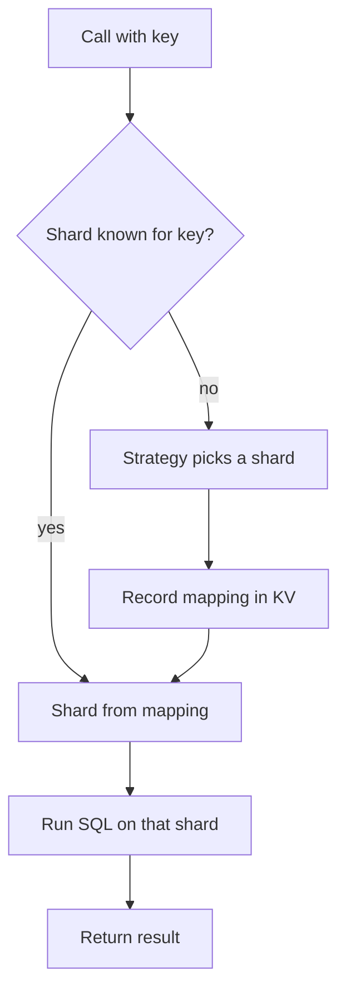

# Getting Started

This page covers a first CollegeDB setup over two shards and the helpers most services add next. It is for developers adding CollegeDB to a new service or to a service whose data already sits in a SQL database. The adapter list, batch support and journal rules are in [Providers](providers.md).

CollegeDB routes each keyed statement to the shard that owns the key. A mapping store records which shard holds a key, and the SQL backend on that shard runs the statement. The examples use PostgreSQL. Each variant names the adapter it changes.

## Install

```bash
bun add @earth-app/collegedb
# or
npm install @earth-app/collegedb
```

## First Run

`createClient` takes one config and returns a client that is ready to use. The example stores mappings in Redis and splits rows across two PostgreSQL pools. `redis` is a connected Redis client, and `poolA` and `poolB` are `pg` pools.

```ts
import { createClient, createPostgreSQLProvider, createRedisKVProvider } from '@earth-app/collegedb';

const client = createClient({
	kv: createRedisKVProvider(redis),
	shards: {
		'db-a': createPostgreSQLProvider(poolA),
		'db-b': createPostgreSQLProvider(poolB)
	},
	strategy: 'hash'
});

await client.ensureSchema('CREATE TABLE IF NOT EXISTS users (id TEXT PRIMARY KEY, name TEXT NOT NULL)');

await client.run('user:1', 'INSERT INTO users (id, name) VALUES (?, ?)', ['user:1', 'Ada']);

const user = await client.first<{ id: string; name: string }>('user:1', 'SELECT id, name FROM users WHERE id = ?', ['user:1']);

const perShard = await client.allAllShards<{ id: string; name: string }>('SELECT id, name FROM users');
const rows = perShard.flatMap((result) => result.results);
```

`ensureSchema` runs the statements on every shard. `run` and `first` take the routing key before the SQL, so the insert and the read for `user:1` reach the same shard. `allAllShards` runs the statement on every shard and returns one result per shard.

<details>
<summary>Variant: MySQL or MariaDB shards</summary>

Replace the two `createPostgreSQLProvider` entries with `createMySQLProvider`. A `mysql2/promise` pool works as is. The SQL in the example does not change.

```ts
import { createClient, createMySQLProvider, createRedisKVProvider } from '@earth-app/collegedb';

const client = createClient({
	kv: createRedisKVProvider(redis),
	shards: {
		'db-a': createMySQLProvider(mysqlPoolA),
		'db-b': createMySQLProvider(mysqlPoolB)
	},
	strategy: 'hash'
});
```

</details>

<details>
<summary>Variant: NuxtHub KV with Drizzle over D1</summary>

This variant runs on NuxtHub. The mapping store is NuxtHub KV, and the shard is the D1 database behind the Drizzle `db` instance. The `sql` tag comes from `drizzle-orm`.

```ts
import { createClient, createNuxtHubKVProvider, createSQLiteProvider } from '@earth-app/collegedb';
import { sql } from 'drizzle-orm';
import { kv } from '@nuxthub/kv';
import { db } from 'hub:db';

const client = createClient({
	kv: createNuxtHubKVProvider(kv),
	shards: {
		'db-primary': createSQLiteProvider(db, sql)
	},
	strategy: 'hash'
});
```

Drizzle over D1 runs a batch one statement at a time and declares no atomic batch. A shard that uses it cannot be the source of a shard move. [Providers](providers.md) lists which adapters can.

</details>

<details>
<summary>Variant: Cloudflare D1 bindings on Workers</summary>

On Workers, build the shard map from the `env` bindings with [One-Call Setup](#one-call-setup-from-a-worker-env). It finds D1 bindings by name and wraps the KV binding for you.

</details>

## Routed Writes

A keyed call resolves its key to a shard before it runs. The diagram shows the `kv` placement path, where each key's shard is recorded in the mapping store.



Under `placement: 'computed'`, the shard comes from the key itself, and KV holds mappings only for keys that were reassigned. Computed placement is opt-in and applies only to the `hash` strategy. The default, `placement: 'kv'`, stores a mapping for every new key. The read path is the same for both placements, so application code does not change between them. The `placement` option is described in [Sharding](sharding.md).

## Read Across Shards

`allAllShards` takes the same SQL and bindings as `all`, runs them on every shard, and returns an array with one `QueryResult` per shard. It takes an optional `batchSize` for the number of concurrent queries (default 50). A read that has a routing key should use `first` or `all` instead, since those touch one shard.

## Module-Level API

The module-level functions, such as `run`, `first` and `initialize`, use one default instance that `initialize` configures. `createClient` is the recommended entry point for new code. Each client holds its own key mapper, caches and placement state, so two clients never share state.

The callback form `collegedb(config, callback)` is the compatibility form. It runs the callback with the config it receives and keeps existing code working:

```ts
import { collegedb, first, run } from '@earth-app/collegedb';

const config = { kv, shards: { 'db-a': shardA, 'db-b': shardB }, strategy: 'hash' as const };

await collegedb(config, async () => {
	await run('user:2', 'INSERT INTO users (id, name) VALUES (?, ?)', ['user:2', 'Grace']);
	return first('user:2', 'SELECT id, name FROM users WHERE id = ?', ['user:2']);
});
```

## Initialization on Workers

`initialize()` starts two background tasks: a sync of the known-shard list and, unless `disableAutoMigration` is set, automatic detection of existing rows on each shard. Work that is not attached to a request is cancelled when the request ends on Workers. Pass `ctx.waitUntil` so the tasks can finish:

```ts
export default {
	async fetch(request: Request, env: Env, ctx: ExecutionContext) {
		initialize({
			kv: env.KV,
			shards: { 'db-east': env.DB_EAST, 'db-west': env.DB_WEST },
			strategy: 'hash',
			waitUntil: (promise) => ctx.waitUntil(promise)
		});

		// ... handle the request
	}
};
```

Calling `initialize` again with the same shard set skips the background work, so a Worker can call it on every request.

`initializeAsync()` awaits both tasks instead. It suits a script or a test, and it adds their latency to the call that makes it.

## Instance Clients

`createClient(config)` returns a client with the same operations as the module-level functions, including `run`, `first`, `all` and `reassignShard`. Clients in one isolate share no router state, so each can serve a separate database group or tenant:

```ts
import { createClient } from '@earth-app/collegedb';

const tenantA = createClient({
	kv: env.KV_A,
	shards: { 'db-a1': env.DB_A1, 'db-a2': env.DB_A2 }
});

const tenantB = createClient({
	kv: env.KV_B,
	shards: { 'db-b1': env.DB_B1 }
});

const user = await tenantA.first('user-1', 'SELECT * FROM users WHERE id = ?', ['user-1']);
await tenantB.run('user-9', 'INSERT INTO users (id) VALUES (?)', ['user-9']);
```

A client does not use `AsyncLocalStorage`, so it works on any runtime, including one without an async context. The module-level functions keep using the default instance, and `createClient` leaves that instance unchanged.

`collegedb(config, callback)` runs its callback in a scope of its own when the runtime exposes `AsyncLocalStorage` through `process.getBuiltinModule`. The callback and the work it awaits use its config, even while another `collegedb` call with a different config runs. The callback does not set the module-level config, so `isInitialized()` is unaffected. Each config keeps its own state, up to eight states per KV store. A later call with the same bindings and options reuses its state, so a Worker that calls `collegedb` on every request keeps its caches warm.

Without that runtime support, the callback runs on the default instance. A callback with a different config that starts while another one runs throws `CONCURRENT_CONFIG`. Use `createClient` for overlapping configurations on such a runtime.

`setPhaseObserver` acts on the default instance only. A client takes its phase observer from the `onPhase` option of its own config.

## One-Call Setup From a Worker env

`initializeFromEnv(env, options)` builds the shard map from `env` and calls `initialize`. It returns the shard names it registered. It finds shards in three ways:

1. A binding named `DB` becomes the `db-primary` shard.
2. Any binding whose name starts with `DB_`, `DB-` or `db-` becomes a shard. The name is lowercased, and `_` becomes `-`, so `DB_EAST` becomes `db-east`.
3. Each binding is resolved with `toProvider`, which recognizes D1, Drizzle and SQLite bindings.

The KV store comes from `options.kv`, or from `env.KV`. A raw Workers KV namespace is wrapped automatically. Without either, the call throws `NO_KV`.

```ts
import { initializeFromEnv, isInitialized } from '@earth-app/collegedb';
import { sql } from 'drizzle-orm';

export default {
	async fetch(request: Request, env: Env) {
		if (!isInitialized()) {
			// pass sql for drizzle bindings; omit it for raw d1
			initializeFromEnv(env, { sql, strategy: { read: 'location', write: 'hash' } });
		}
		// ... routed queries
	}
};
```

The lower-level pieces are exported as well:

- `toProvider(binding, { sql? })` wraps one binding. It returns `null` for a binding it does not recognize.
- `createWorkersKVProvider(env.KV)` adapts a raw Workers KV namespace to the `KVStorage` interface.
- `isInitialized()` reports whether the module-level config is set. It replaces a hand-written `initialized` flag.

## Object-Shaped CRUD

The object helpers build routed statements from plain objects, so the SQL does not need to be written by hand. Each helper takes the routing key first, then the table name. Identifiers are validated and quoted, and values are passed as positional bindings.

```ts
import { insertInto, insertReturning, patch, updateRow, deleteById, deleteRow, upsert } from '@earth-app/collegedb';

// INSERT INTO "users" ("id", "username", "created_at") VALUES (?, ?, ?)
await insertInto('user-123', 'users', { id: 'user-123', username: 'ada', created_at: nowSeconds });

// insert and read the row back in one call
const created = await insertReturning('user-123', 'users', { id: 'user-123', username: 'ada' });

// UPDATE "tickets" SET "status" = ?, "priority" = ? WHERE "id" = ?
await patch('42', 'tickets', 42, { status: 'closed', priority: 'high' });

// UPDATE and DELETE take a where map; an empty map throws EMPTY_WHERE
await updateRow('user-123', 'users', { username: 'ada2' }, { id: 'user-123' });
await deleteById('user-123', 'users', 'user-123');
await deleteRow('user-123', 'sessions', { user_id: 'user-123' });

// INSERT ... ON CONFLICT ("key") DO UPDATE SET "value" = excluded."value"
await upsert('settings:theme', 'settings', { key: 'theme', value: 'dark' }, 'key');
```

`insertReturning` resolves to the row, or `null` when none comes back. The quoting in the comments is the default dialect. MySQL and MariaDB use backticks.

The pure builders `buildInsert`, `buildUpdate`, `buildDelete` and `buildUpsert` return a `{ sql, bindings }` pair without running it. Use them when a statement needs to go through another path, such as a batch.

## Choose a Backend

Each SQL adapter fits one kind of backend. Any SQL adapter works with any mapping store, so the choice of one does not limit the other. The full adapter table, with batch support and journal rules, is in [Providers](providers.md).

| Backend                           | SQL adapter                                                             |
| --------------------------------- | ----------------------------------------------------------------------- |
| PostgreSQL                        | `createPostgreSQLProvider`                                              |
| MySQL or MariaDB                  | `createMySQLProvider`                                                   |
| SQLite file handle                | `createSQLiteProvider`                                                  |
| Cloudflare D1                     | `toProvider`, or [One-Call Setup](#one-call-setup-from-a-worker-env)    |
| Drizzle over one of the above     | The matching adapter, with the Drizzle `sql` tag as the second argument |
| Hyperdrive to PostgreSQL or MySQL | `createHyperdrivePostgresProvider` or `createHyperdriveMySQLProvider`   |
| Tests                             | `createInMemorySQLProvider` with `createInMemoryKVProvider`             |
