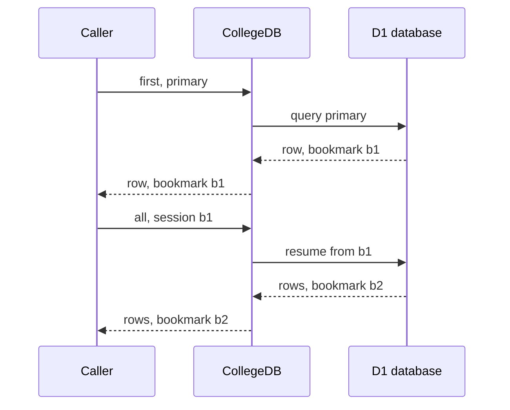
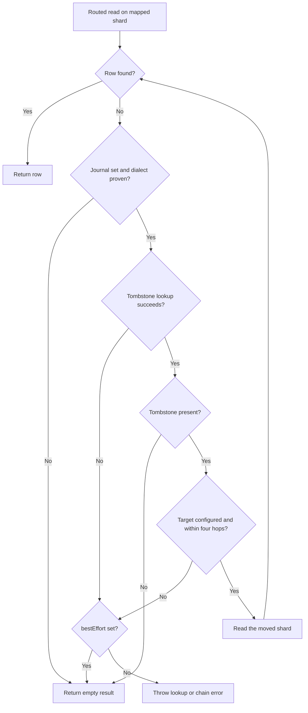

# Reads and Writes

This page covers the read helpers, the per-call `consistency` and `bestEffort` options, routing without a key argument, batched writes, and the configuration that changes how reads and KV calls behave. It is for developers calling CollegeDB's read and write functions, or tuning the routing configuration behind them.

## Resilient Reads and Pagination

`firstResilient()` runs a routed read first. When the routed read returns no row, it runs the same statement on every shard and returns the first match. Use it while some rows may not have a key mapping yet.

```ts
import { firstResilient } from '@earth-app/collegedb';

const user = await firstResilient<User>('user-123', 'SELECT * FROM users WHERE id = ?', ['user-123']);
```

`paginate()` runs a query across all shards and returns one page with the total match count. It takes `page` (1-based, default 1) and `limit` (default 20), and it accepts the sort options of `allAllShardsGlobal()`.

```ts
import { paginate } from '@earth-app/collegedb';

const { results, total, page, pages } = await paginate<User>('SELECT * FROM users WHERE username LIKE ?', ['%ada%'], {
	page: 2,
	limit: 25,
	sortBy: 'created_at',
	sortDirection: 'desc'
});
```

The result also carries `limit` and, when the call used a read session, `bookmarks`. Each page is merged from fresh shard queries, so two pages can reflect different states. Because `paginate()` needs the total, it fetches every matching row from every shard into one isolate. Read [query guidance](query-guidance.md) before using it on a large table.

## Read Consistency

Read helpers accept an optional `consistency` option. Without it, a read opens no session and runs on the shard's default routing.

```ts
import { all } from '@earth-app/collegedb';

const orders = await all<Order>('customer-42', 'SELECT * FROM orders WHERE customer_id = ?', ['customer-42'], {
	consistency: { mode: 'primary' }
});
```

The modes are:

- `primary`: the first query of a D1 session goes to the primary database, and the session continues in sequence. The mode does not promise that every query of the operation runs on the primary.
- `session`: resumes from the bookmarks passed in `bookmarks`, keyed by database id. With no bookmarks, the first query can reach any instance of the database.
- `eventual`: no constraint.

A shard supports a mode unless its `consistency` capability declares that mode `false`. The `session` mode also requires a shard with `withSession`, which D1 bindings provide. The PostgreSQL, MySQL, MariaDB, SQLite and Drizzle adapters report `primary` and `eventual`, not `session`. The in-memory provider reports the same set.

A shard that cannot serve the requested mode throws `CONSISTENCY_UNSUPPORTED` before any query runs. The call does not fall back to a weaker mode. An unknown mode throws `INVALID_CONSISTENCY`.

### Session Bookmarks

Bookmarks are keyed by database id. Set `shardState[binding].id` to the physical database id, which is the D1 database UUID for a D1 binding:

```ts
import { initialize } from '@earth-app/collegedb';

initialize({
	kv: env.KV,
	shards: { 'db-east': env.DB_EAST },
	shardState: { 'db-east': { id: 'your-d1-database-uuid' } }
});
```

A session read that supplies bookmarks for a binding with no `id` throws `BOOKMARK_IDENTITY_UNVERIFIED`. Reads without bookmarks do not need `shardState`.

A read made with a session reports the bookmark it ended on. A single-shard read returns it at `meta.bookmark`. A read that merges several databases returns one bookmark per database at `meta.bookmarks`, keyed by database id. Pass that object back as `bookmarks` to resume. A database with no `id` in `shardState` is left out. `paginate()` and `countAllShards()` return the same object as `bookmarks`.

The diagram shows two reads in one session: a `first()` call in primary mode, then an `all()` call in session mode. The second read resumes from the bookmark that the first read returned.



<details>
<summary>Read helpers that accept consistency</summary>

`first`, `all`, `count`, `countShard`, `countAllShards`, `firstByLookupKey`, `allByLookupKey`, `firstShard`, `allShard`, `firstAllShards`, `allAllShards`, `firstAllShardsGlobal`, `allAllShardsGlobal`, `firstResilient`, `queryFirst`, `queryAll` and `paginate`. The write helpers do not accept the option.

</details>

Each `paginate()` call and each read that merges several shards runs one session per shard. The sessions are independent, so the merged result is not a snapshot across shards.

## Tombstone Follow

When a journal is configured, a routed read that finds no row checks the shard for a tombstone. A tombstone names the shard that the key moved to, and the read continues there. This serves the cutover window after a key moves, so a read still finds the row.

The journal is set with `journalShard`, and the walk does not run without it. The move protocol that writes tombstones is specified in [Migration Protocol](migration-protocol.md). Each shard the walk visits must use SQLite, PostgreSQL or MySQL. On a shard with another dialect the walk stops without an error, and the read returns the empty result.

The flowchart shows how a read with an empty first result proceeds, and where `bestEffort` changes the outcome.



Two errors can stop the walk when `bestEffort` is not set:

- `MIGRATION_LOOKUP_UNAVAILABLE`: the tombstone lookup failed, or the tombstone names a shard that is not configured. Retry the read. The lookup failure carries the underlying error as `cause`.
- `MIGRATION_CHAIN_EXCEEDED`: the moves form a cycle, or the chain is longer than four hops. Retrying does not help.

With `bestEffort: true`, both cases return an empty result instead of throwing. A missing sidecar table counts as no tombstone, so a shard without a tombstone table still answers reads.

## Routing Without a Key Argument

`query()`, `queryFirst()` and `queryAll()` read the primary key out of the statement, so the key is not passed twice:

```ts
import { query, queryFirst } from '@earth-app/collegedb';

await query('INSERT INTO users (id, name) VALUES (?, ?)', ['user-1', 'Ada']);
await query('UPDATE users SET name = ? WHERE id = ?', ['Ada L.', 'user-1']);

const user = await queryFirst<User>('SELECT * FROM users WHERE id = ?', ['user-1']);
```

A statement whose key spans shards is grouped by shard and issued once per shard:

```ts
await query('DELETE FROM users WHERE id IN (?, ?, ?)', ['user-1', 'user-2', 'user-3']);
```

The recognized shapes are `INSERT INTO t (cols) VALUES (...)`, including multi-row inserts, and `UPDATE`, `DELETE` or `SELECT` statements whose entire `WHERE` clause is `key = ?` or `key IN (?, ...)`. The key column defaults to `id`. Declare other key columns per table:

```ts
import { initialize } from '@earth-app/collegedb';

initialize({
	kv: env.KV,
	shards: { 'db-east': env.DB_EAST },
	keyColumns: { tickets: 'ticket_id', sessions: 'session_uuid' }
});
```

### Unroutable Statements

Any other statement is unroutable. CollegeDB throws rather than guessing, because a mis-routed write puts a row on a shard that no reader queries. The error names the explicit-key alternative.

Set `onUnroutable: 'fanout'` to run an unroutable statement on every shard instead. A typo in a column name then becomes a query on every shard rather than an error.

```ts
import { initialize, query } from '@earth-app/collegedb';

initialize({ kv: env.KV, shards, onUnroutable: 'fanout' });

// routed on id
await query('SELECT * FROM users WHERE id = ?', ['user-1']);

// not routable on a key, so this runs on every shard
await query('SELECT * FROM users WHERE email = ?', ['ada@example.com']);
```

To decide per call, plan the statement and choose the helper:

```ts
import { allAllShards, first, planQuery } from '@earth-app/collegedb';

const plan = planQuery(sql, bindings, { keyColumns: { tickets: 'ticket_id' } });

if (plan?.keys.length === 1) {
	await first(plan.keys[0]!, sql, bindings);
} else {
	await allAllShards(sql, bindings);
}
```

The planner reads the SQL string passed to `query()`. A Drizzle query builder chain does not pass through it, so use the key-first helpers for those queries.

## Batched Writes

`batch()` routes each statement by its key, groups the statements by shard, and issues one round trip per shard:

```ts
import { batch } from '@earth-app/collegedb';

const groups = await batch([
	{ key: 'user-1', sql: 'INSERT INTO users (id, name) VALUES (?, ?)', bindings: ['user-1', 'Ada'] },
	{ key: 'user-2', sql: 'INSERT INTO users (id, name) VALUES (?, ?)', bindings: ['user-2', 'Grace'] }
]);

for (const group of groups) {
	if (group.error) console.error(`${group.shard} failed: ${group.error}`);
}
```

Each result holds the shard, the indices of its entries in the input array, the per-statement results, and an `error` string when the whole group failed. The result has no combined success flag, because a batch that spans shards is independent per shard.

Statements on different shards never share a transaction. A batch that spans three shards can leave one shard updated and another not. Key the whole unit of work to one shard when that matters.

Within a shard, the statements run in submission order. Whether they share a transaction depends on the provider. A shard whose provider can run a group in one transaction does so (see the next section). Other providers run the statements one at a time with no transaction.

Routing a batch reads the mappings for all of its keys in one `getMany` call when the store has one, and writes new mappings with one `putMany` call. Stores without `getMany` or `putMany` use bounded concurrent single-key calls, 32 at a time. The Redis and Valkey adapters implement both when the client has `mGet` and `mSet`, and the in-memory adapter implements both. The Workers KV adapter's `putMany` issues single `put` calls, so it does not make one write for the whole set. See [Bulk KV Round Trips](#bulk-kv-round-trips) below.

### Transactions Inside a Batch

A shard runs its group in one transaction when its provider can give the batch a connection to run on. A binding with a native `batch` method, such as D1, runs the group through that method. The PostgreSQL, MySQL and SQLite adapters need to know where a connection comes from, because `BEGIN`, the statements and `COMMIT` form one transaction only when they use the same connection:

```ts
// a pool is recognized and leased from per batch.
createPostgreSQLProvider(new Pool({ connectionString }));
createMySQLProvider(mysql.createPool({ uri }));

// a single connection has to say so; a pool must not.
createPostgreSQLProvider(new Client({ connectionString }), { singleConnection: true });
createSQLiteProvider(new Database('app.db'), { singleConnection: true });

// anything else supplies its own lease.
createPostgreSQLProvider(handle, {
	lease: async () => {
		const client = await myPool.acquire();
		return { client, release: () => myPool.release(client) };
	}
});
```

A handle that CollegeDB cannot place runs its statements one at a time, with no transaction. CollegeDB does not guess. The `pg` package's `Client` and `Pool` both expose `connect()`, and either can be wrapped in an object that exposes only `query()`. Sending `BEGIN` to an unidentified handle could bracket a different connection from the one that runs the statements.

On a shard that runs its group in one transaction, a failed statement rolls the whole group back. `batch()` reports the failure in that shard's `error` field instead of throwing.

## Idempotent Schema Across Shards

`ensureSchema()` runs DDL on every configured shard. It accepts an array of statements, or one string with statements separated by semicolons. Two guards skip work that has already run. The `once` option skips a schema the same process has already applied to the same shards. The `versionKey` option stores a version marker in KV, and the schema is skipped while the stored value equals `version`. The default `version` is `'1'`.

```ts
import { ensureSchema } from '@earth-app/collegedb';

await ensureSchema(
	[
		'CREATE TABLE IF NOT EXISTS users (id TEXT PRIMARY KEY, username TEXT NOT NULL)',
		'CREATE INDEX IF NOT EXISTS idx_users_username ON users (username)'
	],
	{ versionKey: 'schema:version', version: '3' }
);
```

The guards save work. They do not make DDL safe to rerun, so write each statement with `IF NOT EXISTS`.

## Configuration Edge Cases

### Reads That Find Nothing

With `allocateOnRead` set to `false`, the default, a read resolves a shard and returns it without writing to KV. A lookup for a key with no row therefore costs no KV write and leaves no mapping behind. Writes always record their mapping.

Set `allocateOnRead: true` to record a mapping on every routed read:

```ts
import { initialize } from '@earth-app/collegedb';

initialize({
	kv: env.KV,
	shards: { 'db-east': env.DB_EAST },
	allocateOnRead: true
});
```

### Reassignment and the Mapping Cache

`mappingCacheTtlMs` sets how long a process keeps a key's shard in memory. The default is 30 seconds. The TTL is a consistency window. The process that calls `reassignShard()` routes correctly at once, because it clears its own cache entry. Other processes keep routing the key to the old shard until their entry expires.

```ts
import { reassignShard } from '@earth-app/collegedb';

await reassignShard('user-123', 'db-west', 'users');
// this isolate now routes user-123 to db-west.
// other isolates may route it to db-east for up to mappingCacheTtlMs.
```

With more than one shard configured, `reassignShard()`, `rebalance()` and `recoverMigrations()` need `journalShard` and throw `JOURNAL_NOT_CONFIGURED` without it.

Lower the TTL when a reassignment must take effect quickly across isolates. The cost is more KV reads. Set it to `0` to read the mapping on every call:

```ts
initialize({ kv: env.KV, shards, mappingCacheTtlMs: 0 });
```

Under `placement: 'computed'`, `reassignShard()` also adds an exception to the placement manifest and increments its `exceptionsVersion`. Other isolates discard their cached exception set on their next manifest refresh.

### Legacy Multi-Key Mappings

A mapping miss reads one KV key. The `legacyMultiKeyLookup` option also reads a second, multi-key record. Writers since 1.0.3 store a single-key record for each lookup key, so the second read cannot succeed for that data, and it doubles the KV cost of every miss. Enable the option only while migrating mappings written before 1.0.3:

```ts
initialize({ kv: env.KV, shards, legacyMultiKeyLookup: true });
```

### Bulk KV Round Trips

Stores with native multi-get and multi-set calls are used in bulk when the adapter exposes them. This matters for multi-key mappings, which otherwise cost one round trip per lookup key. The Redis and Valkey adapters detect `mGet` and `mSet` when the adapter is constructed. Adapters without them fall back to concurrent single operations, so no call site needs to check.

```ts
import { createRedisKVProvider } from '@earth-app/collegedb';

const kv = createRedisKVProvider(redisClient);

// present only when the client supports it
await kv.putMany?.([
	{ key: 'a', value: '1' },
	{ key: 'b', value: '2' }
]);
```

On Workers KV, `getMany` issues bulk gets of up to 100 keys each, with up to four requests in flight, and `batch()` uses it to read mappings. `putMany` issues one `put` per entry, with up to 16 in flight. Set `putConcurrency` in `createWorkersKVProvider()` to change that limit. The writes are not atomic. A failed put rejects with `KV_PUT_MANY_FAILED`, and the message names the key. Entries written before the failure stay written.

### KV Timeouts

`kvTimeoutMs` limits each KV call that the router makes. A call that runs longer rejects with `KV_TIMEOUT`. It never resolves as a missing key, so a stalled read cannot send a lookup down the "not mapped" path. The underlying call is not cancelled, so a write that times out can still complete.

```ts
import { initialize } from '@earth-app/collegedb';

initialize({
	kv: env.KV,
	kvTimeoutMs: 2000,
	shards: { 'db-east': env.DB_EAST }
});
```

`withKVTimeout(kv, timeoutMs)` applies the same wrapper to a store used outside the router.
