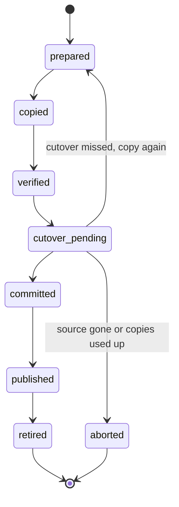
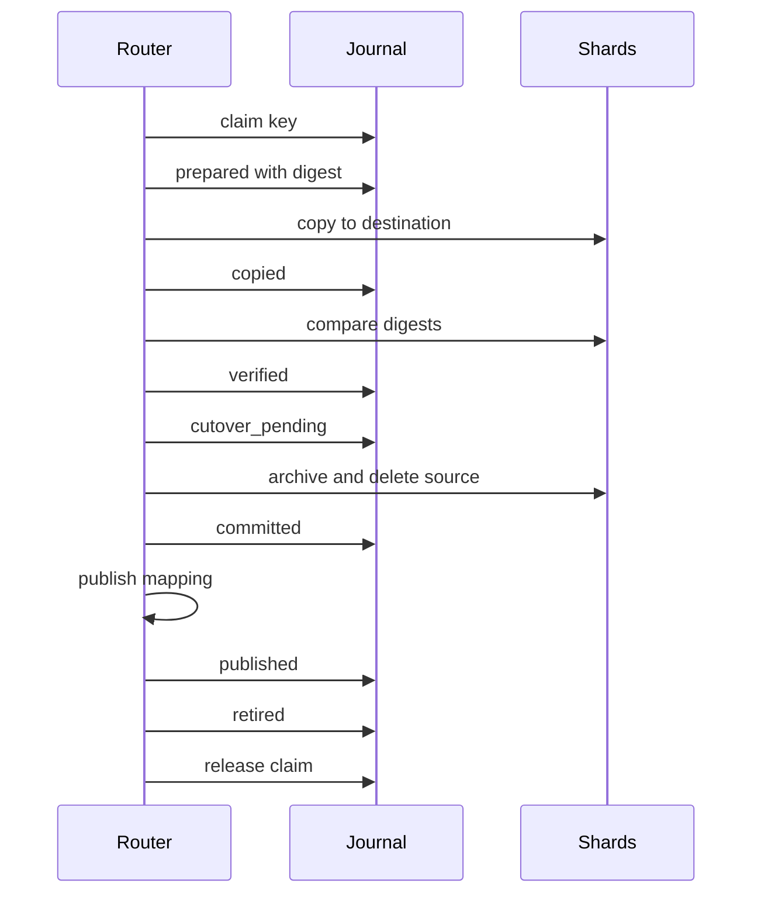
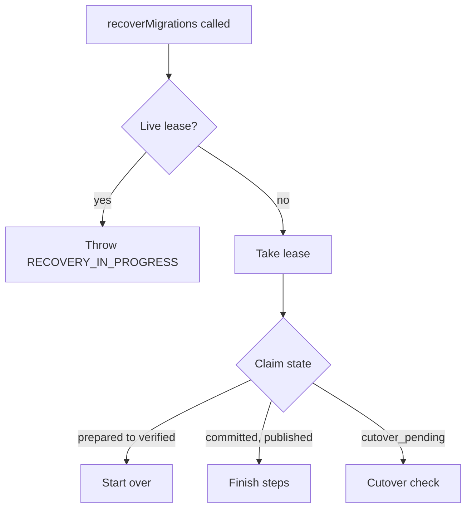
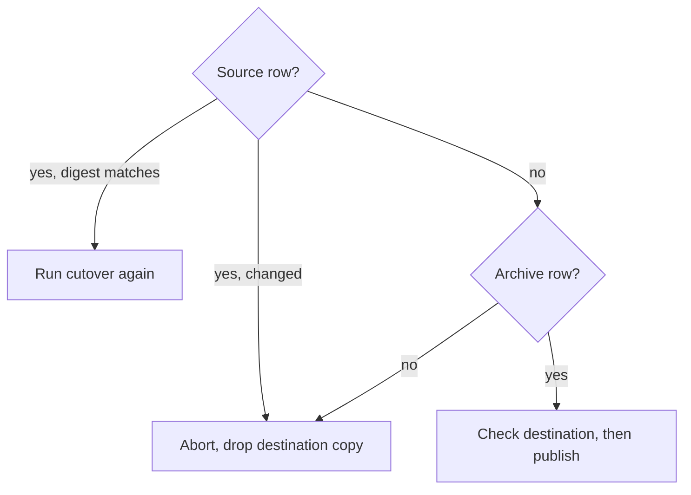

# Shard Moves

This page covers moving a key's rows from one shard to another, the topology and epoch records that route keys during a change, and reconciling the coordinator's allocation ledger. It is for anyone running `reassignShard`, `rebalance` or `recoverMigrations`, and for anyone scheduling recovery. The [migration protocol](migration-protocol.md) holds the proofs and names the test behind each claim. This page describes what the API does and what the caller has to arrange.

## Safe Shard Moves

`reassignShard`, `rebalance` and `recoverMigrations` move rows through a journal. The journal records each step before the work for that step runs, so `recoverMigrations()` can finish or abort a move that a crash interrupted. The journal lives on the shard named by `journalShard`:

```typescript
import { initialize, reassignShard, recoverMigrations } from '@earth-app/collegedb';

initialize({
	kv: env.KV,
	shards: { 'db-east': env.DB_EAST, 'db-west': env.DB_WEST },
	strategy: 'hash',
	journalShard: 'db-east'
});

await reassignShard('user-california-123', 'db-west', 'users');

// run after any deploy that may have interrupted a move
await recoverMigrations();
```

A move is per key, not per table. `reassignShard` moves one table's row for one key. An organization whose related rows sit in several tables needs one move per table, which is an application procedure.

### Configuration

`journalShard` names the binding that holds the journal tables. `initialize` rejects a value that is not a configured binding with `INVALID_JOURNAL_SHARD`. With more than one shard and no `journalShard`, `reassignShard` and `recoverMigrations` throw `JOURNAL_NOT_CONFIGURED`, and so does a `rebalance` that is not a dry run. A single-shard configuration uses its only shard as the journal.

`journalScope` (default `'default'`) keeps separate journals when several sets share one database. With `journalShard` set, every data shard also holds the `collegedb_retired` and `collegedb_topology` tables.

`createClient(config)` exposes `reassignShard`, `rebalance`, `recoverMigrations`, `verifyMigrations`, `pruneEpochs` and `reconcileAllocations` as methods. Each client reads `journalShard` and `journalScope` from its own config.

### Requirements

A move runs only between shards on a proven dialect: SQLite (including D1 and a raw binding with no `dialect`), Postgres, and MySQL or MariaDB. A shard on any other dialect throws `MIGRATION_UNSUPPORTED_DIALECT`.

The source and destination shards must also declare `atomicBatch`, which means their `runBatch` rolls back the whole group when one statement fails. A shard without the declaration refuses with `MIGRATION_NO_ATOMIC_BATCH`. A shard with no `runBatch` at all refuses with `MIGRATION_NO_BATCH`.

These adapters declare `atomicBatch`:

- The native Postgres, MySQL, MariaDB and SQLite adapters.
- The Drizzle adapters over Postgres, MySQL, MariaDB and `bun:sqlite`.
- The Hyperdrive Postgres and MySQL providers.
- A D1 binding passed through `toProvider`, tested on local workerd.

Drizzle over D1 and libsql over HTTP declare nothing, so a move from either refuses. Rollback on production D1 is unproven (see [limits](#limits)).

Single-connection adapters (`singleConnection: true`) hold their other statements until an open batch commits. A caller `lease` gates statements only when `singleConnection: true` is also set. Pooled adapters are not affected.

### Write Ordering and Recovery

Every router-issued write either commits before the cutover and is reflected in the cutover's comparison, or runs after the source is fenced and cannot create a stale source row. A write that cannot tell which shard owns the key fails with `MIGRATION_CUTOVER_PENDING`. It is never acknowledged.

A crash after the cutover leaves the key readable, and its writes fail with `MIGRATION_CUTOVER_PENDING` until `recoverMigrations()` runs. Schedule recovery for this reason. `getMigrationStatus(key, table)` returns the latest recorded state of the key's move, or `null` when there is none.

A read that finds nothing on a shard that holds a tombstone for the key follows the tombstone's `moved_to` shard, up to four hops. The read checks for tombstones only when `journalShard` is set. A failed tombstone lookup, a chain longer than four hops, a cycle, or a tombstone that names an unconfigured shard throws `MIGRATION_LOOKUP_UNAVAILABLE` or `MIGRATION_CHAIN_EXCEEDED`. Pass `bestEffort: true` in the read options to return the not-found result instead.

### Move States

An operation moves through `prepared`, `copied`, `verified`, `cutover_pending`, `committed`, `published` and `retired`. Each state is a journal row written before the work that follows it. A cutover that misses returns the operation to `prepared` for another copy, up to three times. `aborted` ends an operation without moving the key.



The diagram follows the states in the migration protocol. Recovery resumes an operation from its last recorded state, using the rules in the protocol's recovery table.

### Move Sequence

The next diagram shows one successful move. The router drives each step, and it writes the matching journal row first. After the copy, it reads the destination row and compares digests. After the commit, it publishes the mapping and the placement exception. "Shards" stands for the source and destination shards, which the router reaches through their bindings.



The source cutover is one batch on the source shard. It inserts the archive row into `collegedb_retired` and deletes the source row under one predicate. A write that changed the row first makes the predicate fail, so the cutover writes nothing and the move is retried.

### Recovery Lease

Only one recovery runs per journal scope at a time, across isolates. `recoverMigrations()` takes a lease row in the journal first. The lease lasts 60 seconds without renewal. A call while the lease is live throws `RECOVERY_IN_PROGRESS`, which is the normal result for a scheduler that calls on every tick. The first call after a crashed recovery takes the lease over at a higher generation.

A recovery that loses its lease stops and throws `RECOVERY_FENCED`. It makes no further writes, and the next scheduled call starts a fresh recovery. A live move does not take the lease. `verifyMigrations({ repair: true })` does.

The first flowchart covers the lease check and the claim states. A claim in `prepared`, `copied` or `verified` state starts again from a fresh snapshot. A claim in `committed` or `published` state finishes the remaining steps. A claim in `cutover_pending` state goes to the cutover check in the second flowchart.



The cutover check reads the source row. If the row is still there and its digest matches, the cutover runs again. If the row has changed, the move aborts. If the row is gone, the archive row for the operation decides the outcome: when it exists, the destination is checked and the move is published; when it does not, the move aborts. Every abort drops the destination copy.



The protocol's recovery table lists every state, and it is the reference for edge cases.

A Workers scheduler runs recovery from `scheduled()` and treats `RECOVERY_IN_PROGRESS` as success:

```typescript
import { CollegeDBError, initialize, recoverMigrations } from '@earth-app/collegedb';

export default {
	async scheduled(controller: ScheduledController, env: Env, ctx: ExecutionContext) {
		initialize({
			kv: env.KV,
			shards: { 'db-east': env.DB_EAST, 'db-west': env.DB_WEST },
			strategy: 'hash',
			journalShard: 'db-east',
			waitUntil: (promise) => ctx.waitUntil(promise)
		});

		try {
			const report = await recoverMigrations();
			if (report.failed.length > 0) {
				console.error('moves needing attention', report.failed);
			}
		} catch (error) {
			if (error instanceof CollegeDBError && error.code === 'RECOVERY_IN_PROGRESS') {
				return;
			}
			throw error;
		}
	}
};
```

A `RECOVERY_FENCED` error can also propagate. The Worker run fails, the lease belongs to another holder, and the next tick recovers normally.

`RecoveryReport` lists `examined`, `committed`, `aborted`, `released`, `skipped` and `failed`. An entry in `failed` names the operation, the key and the error, and the operation is left as it was.

### Stale Executors and Verification

A recovery that stalls between its lease check and a shard write can still run that one write after another recovery takes over. Its journal writes are fenced, so it never returns a report and throws `RECOVERY_FENCED`. The stale write can leave a stranded copy on the destination of an aborted move, or archive a source row after the new holder aborted the move.

`verifyMigrations()` reports these leftovers and changes nothing. Its report has these fields:

- `danglingOps`: operations still active in the journal.
- `ghosts`: live rows on a shard that also holds a tombstone for the key.
- `strandedArchives`: tombstones with no journal record.
- `strandedCopies`: live rows on the destination of an aborted move that equal a row the move journaled.
- `staleCutovers`: tombstones whose move the journal ended as aborted. Each entry says whether it is `restorable`.
- `repaired`: what `repair` changed.
- `clean`: true when nothing remains to report.

`verifyMigrations({ repair: true })` runs recovery first, so it takes the lease. It removes a ghost only when the row equals the archived payload. It removes a stranded copy by the same proof the abort used. It restores the archived row of a stale cutover only when the operation is the newest on the key, the archive still holds its payload, and the destination has no row. Otherwise the entry is reported with `restorable: false` and left as it is.

One case cannot be detected. A stale destination insert lands after the new holder committed the move and an acknowledged delete removed the key. The protocol describes the conditions and the test that pins this behavior.

### Single-Row Copy

`migrateRecord(source, target, primaryKey, tableName, options)` copies one row from one database to another, then deletes the source row. It writes no journal, so a crash between the two writes is not recoverable. Use `reassignShard` when that matters.

`pkColumn` names the key column (default `id`). With `onConflict: 'fail'` (the default), a destination row that differs from the source makes the copy fail with `DESTINATION_CONFLICT`. An identical destination row counts as a retried copy. `onConflict: 'replace'` overwrites the destination row.

### Retention and Purge

The archived source row is kept for seven days by default. `retire: { afterMs }` on `reassignShard` changes the period. `retire: 'immediate'` sets the deadline to now, but it does not purge anything by itself.

`purgeRetired()` clears the archived payload of a retired operation. It refuses an operation with `RETENTION_NOT_ELAPSED` before the deadline, and with `NOT_VERIFIED` when no clean verification pass has run since the move finished. Its report lists the `purged` and `refused` operations. The tombstone stays after a purge, so stale writers remain refused. Restoring an old row is a new explicit move from the archive.

### Limits

- The journal covers statements that CollegeDB routes. Raw SQL and raw `run()` or `all()` statements bypass it.
- Each move covers one table row. A `reassignShard` on one table leaves the key's rows in other tables where they were.
- Nothing is atomic across shards. The journal makes an interrupted move recoverable, and it does nothing more.
- Crash recovery is not a backup or a restore.
- Rollback of a failing batch on production D1 is unproven. The D1 declaration rests on local workerd runs.

### Reassignment and the Mapping Cache

`mappingCacheTtlMs` (default 30000 milliseconds) limits how long another process keeps routing a key to its old shard after a reassignment. The process that calls `reassignShard` is correct at once, because it clears its own cache entry. Other processes keep the old shard until their cached entry expires:

```typescript
import { reassignShard } from '@earth-app/collegedb';

await reassignShard('user-123', 'db-west', 'users');
// this isolate routes user-123 to db-west now
// other isolates may route it to db-east for up to mappingCacheTtlMs
```

Lower the TTL when a reassignment has to take effect quickly across isolates. The cost is more KV reads. A value of `0` reads the mapping on every call:

```typescript
initialize({ kv: env.KV, shards, mappingCacheTtlMs: 0 });
```

`reassignShard` throws `MAPPING_NOT_FOUND` when the key has no mapping and no computed owner. Under computed placement, a reassignment also bumps the manifest's exception version, so other isolates discard their cached exception set on the next manifest refresh.

## Topology and Epochs

With `placement: 'computed'`, a key's shard comes from a placement manifest. The manifest is an ordered list of epochs, newest first. Each epoch records a shard set and the algorithm that computes an owner from it. A key placed under an older epoch still resolves through that epoch. [Computed placement](sharding.md#computed-placement) explains the routing.

A manifest holds at most 8 epochs, the current one included. Creating a ninth throws `TOO_MANY_EPOCHS`. CollegeDB never drops an epoch to make room, because a key placed under it would stop resolving. Move keys to their current owners and run [pruning epochs](#pruning-epochs) first.

A read that misses on the newest epoch checks older epochs, one query each. A key found through an older epoch is stored as a placement exception on its first hit, so later reads go straight to it. A move records a placement exception only when its destination differs from the computed owner.

### Manifest Storage

With `journalShard` set on a proven dialect, the manifest is the `collegedb_manifest` row on the journal shard. Every update is a compare-and-swap on the manifest revision. A writer that loses five swaps in a row throws `PLACEMENT_CONFLICT`. KV holds a derived copy that isolates refresh on a timer.

A read may use a cached manifest when KV cannot confirm the current one. A write needs a fresh manifest. When a write cannot confirm one, it throws `PLACEMENT_UNVERIFIED` and routes nothing. Retry the call.

### Topology Fence

Each data shard holds a fence, `min_generation`, in `collegedb_topology`. A write binds the generation of the manifest it routed with. A guarded insert or upsert matches no row while the fence is above that generation.

The router distinguishes three zero-row results. A raised fence means the manifest is stale. The router reloads it once and throws `STALE_TOPOLOGY` if the write still cannot land. A tombstone follows the builder write rules in the [migration protocol](migration-protocol.md). An ignored conflict is a real zero-row result.

### Writes After a Topology Change

After a topology change, a write first finds the shard that holds its row. The router probes the shards for the table's key column, which is `id` unless `keyColumns` names another one. It writes to the shard that has the row. A key no shard holds goes to the newest owner. When a probe cannot run, the write throws `WRITE_UNRESOLVED` and is not applied.

The probe checks the key column only. A statement keyed on another column is not checked by this probe. The protocol lists that case as unproven.

### Pruning Epochs

`pruneEpochs({ tables, pkColumns, dryRun, pageSize, concurrency })` drops every epoch that no row depends on. It requires `journalShard` and throws `JOURNAL_NOT_CONFIGURED` without one. A failure to read the exception set throws `PRUNE_REFUSED`. List every table that holds keyed rows in `tables`. A census over fewer tables cannot show that no row depends on an epoch.

A run raises the fence on every shard, counts the rows that depend on each epoch, and publishes the shorter manifest through the same compare-and-swap. A row depends on the newest epoch whose owner is the shard the row sits on. A key keeps an epoch when it has a placement exception and a mapping that points at the shard the row sits on. A KV mapping alone does not keep an epoch.

With `dryRun: true`, the call returns the dependents of each epoch and changes nothing, the fence included. A writer that holds a manifest older than the fence is refused with `STALE_TOPOLOGY`.

```typescript
import { pruneEpochs } from '@earth-app/collegedb';

const plan = await pruneEpochs({ tables: ['users', 'tickets'], dryRun: true });
console.log(plan.dependents);

const report = await pruneEpochs({ tables: ['users', 'tickets'] });
console.log(report.removed, report.retained);
```

`PruneReport` lists the `removed` and `retained` epoch numbers, the `dependents` count for each epoch, and `scanned`, the rows one census pass read.

## Reconciling Allocations

`reconcileAllocations` compares the coordinator's allocation ledger with routing: the KV mapping, or the computed owner for a key with no mapping. The KV mapping is the record, and the ledger is advisory. Call it after `initialize`. It throws `COORDINATOR_NOT_CONFIGURED` when the config has no `coordinator`.

Routing agreement does not show that a row exists. Pass `verifyRecords` with the tables to check. Each key's primary key is probed on the shard that routing points at, which is the ledger shard when a key has no mapping. `pkColumn` names the key column of a table and defaults to `id`. Without `verifyRecords`, no shard is queried, and every examined row counts as `recordUnchecked`. With it, each row lands in one count: `recordVerified` when a listed table holds the key, `recordMissing` when none does, and `recordUnchecked` when the probe could not run. A probe cannot run when the shard is not configured, the table list is empty, or the query throws.

A row on the routed shard is not proof that it is the authoritative copy. A shard that holds a tombstone can keep a retained row, and for moved keys the journal is the authority.

The run writes nothing unless a flag is set:

- `repair: true` writes a KV mapping for each key that has neither a KV mapping nor a computed owner. It uses the ledger shard, and only when the probe finds the row there. It requires `verifyRecords`, and the call throws `RECONCILE_VERIFY_REQUIRED` without it.
- `pruneVerified: true` removes ledger rows that agree with routing and have an explicit KV mapping. With `verifyRecords`, the row must also be verified. Rows that match only the computed placement stay.

Disagreements are reported and never resolved. Key lists in the report hold at most 1000 entries, and the counts are exact.

```typescript
import { reconcileAllocations } from '@earth-app/collegedb';

const report = await reconcileAllocations({
	limit: 100,
	verifyRecords: { tables: [{ table: 'users' }] }
});
console.log(report.examined, report.routingAgreed, report.recordMissingCount, report.disagreeingCount);
```
