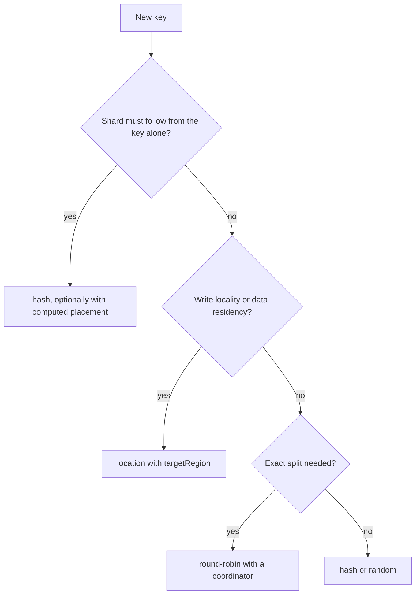
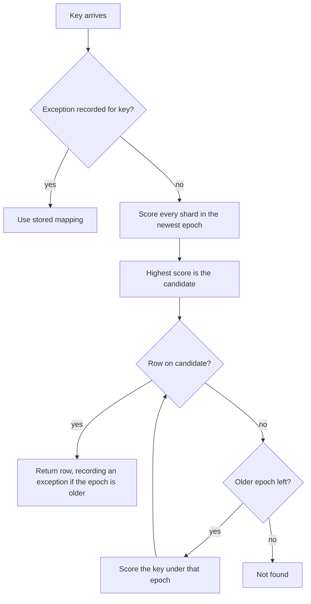

# Sharding

This page covers how a key picks its shard: the strategies, computed placement, shard eligibility, the size limit and lookup keys. Read it before you choose a strategy or add a shard. Moving rows that already exist is covered in [shard moves](shard-moves.md).

## Sharding Strategies

The strategy decides where a new key lands the first time it is written. After that the key stays on the shard it was given. Every later read and write follows the recorded mapping, whatever the strategy says now. The strategy therefore sets how keys spread across shards. It does not route each query by itself.

| Strategy      | New key goes to                                      | Recomputable from the key | Shared state                              |
| ------------- | ---------------------------------------------------- | ------------------------- | ----------------------------------------- |
| `hash`        | The eligible shard with the highest rendezvous score | Yes                       | None                                      |
| `round-robin` | The next eligible shard in order                     | No                        | One counter, held by a coordinator if set |
| `random`      | A random eligible shard                              | No                        | None                                      |
| `location`    | The eligible shard nearest `targetRegion`            | No                        | None                                      |

`hash` is the default. It is also the only strategy that supports [computed placement](#computed-placement), because it is the only one whose result depends on the key alone. Scores are taken over the shards that accept new keys (see [shard eligibility](#shard-eligibility)).

The flowchart shows which strategy the three usual questions point to:



```typescript
import { getShardStats, initialize, run } from '@earth-app/collegedb';

initialize({
	kv: env.KV,
	shards: { 'db-a': env['db-a'], 'db-b': env['db-b'], 'db-c': env['db-c'] },
	strategy: 'hash'
});

for (let i = 0; i < 300; i++) {
	await run(`user-${i}`, 'INSERT INTO users (id, name) VALUES (?, ?)', [`user-${i}`, `User ${i}`]);
}

// key counts per shard
console.log(await getShardStats());
```

### Choosing a Strategy

`hash` needs no shared state and no running coordinator. Key counts differ between shards, and they differ more when the key count is small.

`round-robin` gives an exact split, but only through a coordinator, which holds one counter for every isolate. Without a coordinator each isolate keeps its own counter. Each isolate then spreads its keys evenly, and the shards taken together may not be even.

`random` needs no shared state. Its split evens out over enough keys, and it varies more than `hash` when the key count is small.

`location` sends new keys to the shard nearest `targetRegion`. The shard's `priority` in `shardLocations` adjusts the distance score. Shards without a `shardLocations` entry are never picked by `location`, and when no shard has one, the strategy falls back to `hash`. Use `location` for write locality or data residency. It concentrates a region's new keys on one shard, so it does not spread load.

### Adding and Removing Shards

An existing key keeps its recorded mapping. A new shard therefore receives only the keys written after it joins, and reads of existing keys need no change:

```typescript
// Before: two shards. After: three. Existing rows stay where they are.
initialize({
	kv: env.KV,
	shards: { 'db-a': env['db-a'], 'db-b': env['db-b'], 'db-c': env['db-c'] },
	strategy: 'hash'
});
```

To move existing keys onto the distribution the new shard set implies, run `rebalance`. A dry run reports what it would do and changes nothing:

```typescript
import { initialize, rebalance } from '@earth-app/collegedb';

initialize({
	kv: env.KV,
	shards: { 'db-a': env['db-a'], 'db-b': env['db-b'], 'db-c': env['db-c'] },
	strategy: 'hash',
	journalShard: 'db-a'
});

const preview = await rebalance('users', { dryRun: true });
console.log(`${preview.moved} of ${preview.examined} keys would move`);

const applied = await rebalance('users', { concurrency: 10 });
console.log(`moved ${applied.moved}, failed ${applied.failed.length}`);
```

A pass that is not a dry run needs a journal, so `journalShard` must be set. Without one, the call throws `JOURNAL_NOT_CONFIGURED`. Each key moves as a journaled move, which [shard moves](shard-moves.md) describes in full. Up to `concurrency` keys move at once. When `concurrency` is not passed, `migrationConcurrency` applies, and 25 when that is unset. A key that fails is listed in `failed` with its error, and the pass continues. A key already on its target counts as `agreed`, so a second pass after an interruption skips the keys the first one finished.

For a key k and an eligible shard s, h(s, k) is a 32-bit hash of the shard name and the key joined by a colon. The owner of k is the shard with the highest score, and ties go to the lower shard name. The hash is FNV-1a followed by the MurmurHash3 finalizer:

```math
\mathrm{owner}(k) = \mathrm{argmax}_{s}\, h(s, k)
```

A key moves only when a newly added shard outscores its current owner. Under a uniform hash, the expected share of keys that move when one shard joins is one in N, where N is the shard count after the change:

```math
\frac{\text{keys moved}}{\text{keys}} \approx \frac{1}{N}
```

This is the expected value, and the repository does not measure it. Removing a shard moves only the keys that the shard owned.

To take a shard out of new allocations, set its `drain` state to `draining` (see [shard eligibility](#shard-eligibility)). Draining shards stay readable. Then run `rebalance`. Its target for each key comes from the eligible shards only, so keys still mapped to a draining shard move to an eligible one.

### Location Example

```typescript
import { collegedb, first, run } from '@earth-app/collegedb';

collegedb(
	{
		kv: env.KV,
		strategy: 'location',
		targetRegion: 'wnam',
		shardLocations: {
			'db-west': { region: 'wnam', priority: 2 },
			'db-east': { region: 'enam', priority: 1 },
			'db-europe': { region: 'weur', priority: 0.5 }
		},
		shards: {
			'db-west': env.DB_WEST,
			'db-east': env.DB_EAST,
			'db-europe': env.DB_EUROPE
		}
	},
	async () => {
		// new keys go to the shard nearest wnam
		await run('user-west-123', 'INSERT INTO users (id, name, location) VALUES (?, ?, ?)', [
			'user-west-123',
			'West Coast User',
			'California'
		]);

		const user = await first<{ name: string }>('user-west-123', 'SELECT * FROM users WHERE id = ?', ['user-west-123']);
		console.log(`found ${user?.name}`);
	}
);
```

### Mixed Strategy Example

A mixed strategy names one strategy for writes and one for reads:

```typescript
import { collegedb, first, run, type MixedShardingStrategy } from '@earth-app/collegedb';

const mixedStrategy: MixedShardingStrategy = {
	write: 'location',
	read: 'hash'
};

collegedb(
	{
		kv: env.KV,
		strategy: mixedStrategy,
		targetRegion: 'wnam',
		shardLocations: {
			'db-west': { region: 'wnam', priority: 2 },
			'db-east': { region: 'enam', priority: 1 },
			'db-central': { region: 'enam', priority: 1 }
		},
		shards: {
			'db-west': env.DB_WEST,
			'db-east': env.DB_EAST,
			'db-central': env.DB_CENTRAL
		}
	},
	async () => {
		await run('user-california-456', 'INSERT INTO users (id, name, location) VALUES (?, ?, ?)', [
			'user-california-456',
			'California User',
			'Los Angeles'
		]);

		const user = await first<{ name: string; location: string }>('user-california-456', 'SELECT * FROM users WHERE id = ?', [
			'user-california-456'
		]);
		console.log(`User: ${user?.name}, Location: ${user?.location}`);
	}
);
```

The read strategy does not change where a stored key is read from. A read goes to the key's recorded shard. The read strategy only picks a shard for a key with no mapping, and that pick is not saved unless `allocateOnRead` is set. A mixed strategy therefore separates where writes land from how unmapped keys are looked up, and nothing more.

## Computed Placement

For the `hash` strategy the shard is already a function of the key. `placement: 'computed'` uses that function directly, so routing skips the KV read and new keys are not recorded as mappings:

```typescript
initialize({
	kv: env.KV,
	shards: { 'db-east': env.DB_EAST, 'db-west': env.DB_WEST },
	strategy: 'hash',
	placement: 'computed'
});
```

The flowchart shows how a read finds a key. Without an exception, the lookup scores the key under each epoch, newest first, and stops at the first epoch whose candidate holds the row.



Each older epoch costs one more query on a miss. A row found under an older epoch is recorded as an exception, so later reads go straight to it. Placement is recorded in a manifest of epochs, and a key placed under an older epoch keeps resolving through it. [Topology and epochs](shard-moves.md#topology-and-epochs) covers the manifest.

Computed placement applies only when the read and write strategies are both `hash`. With any other strategy, CollegeDB keeps using stored mappings.

Computed placement does not store a mapping for each key, so anything that lists keys per shard reads only what was stored. This includes the key counts from `getShardStats` without a coordinator and `KVShardMapper.getKeysForShard`. Keys that computed placement never stored do not appear in them.

For a deployment that already has stored mappings, run a dry-run `rebalance` first. It reports how many keys already agree with their computed shard:

```typescript
import { rebalance } from '@earth-app/collegedb';

const result = await rebalance('users', { dryRun: true });
console.log(`${result.agreed}/${result.examined} keys already agree, ${result.moved} would move`);
```

When a pass reports no moves and no failures, computed placement resolves every key to the shard its stored mapping already names. Keys moved by `reassignShard` stay recorded as exceptions and still resolve through KV.

## Shard Eligibility

Each shard binding can carry a `ShardState` in the `shardState` config field:

- `id` is the physical database id. Session bookmarks are matched by it, so a topology change cannot apply one database's bookmark to another.
- `writable` (default `true`) keeps a shard out of new allocations when set to `false`. Its existing keys stay readable and writable.
- `drain` (default `'active'`) takes `'draining'` or `'retired'`. Only `active` shards take new keys. Draining and retired shards stay readable, and keys placed under older epochs keep resolving through them.
- `tags` are labels that the `eligible` predicate can read, such as a jurisdiction.

```typescript
import { initialize, publishEligibility } from '@earth-app/collegedb';

initialize({
	kv: env.KV,
	shards: { 'db-eu': env.DB_EU, 'db-us': env.DB_US },
	strategy: 'hash',
	shardState: {
		'db-eu': { id: 'eu-database-uuid', tags: { jurisdiction: 'eu' } },
		'db-us': { drain: 'draining' }
	},
	eligible: (shard, context) => context.tags.jurisdiction === 'eu'
});

await publishEligibility();
```

### Eligibility Predicate

`eligible(shard, context)` decides whether a shard takes new keys. The context carries the `operation`, the `key` when there is one, the shard's `tags` and its full `state`. The checks run in this order: `shardState` first, then the predicate, then the size limit. Only a predicate result of `true` keeps a shard in. Any other value keeps it out.

The predicate runs with `operation: 'allocate'` for each new key under KV placement. Under computed placement it also runs with `operation: 'publish'` when an epoch is published, which `publishEligibility()` does on demand. The result becomes a topology epoch. Reads and keys that already have a mapping do not consult the predicate. Under computed placement a new epoch changes the owner of new keys, and existing keys keep resolving through the epochs they were placed under.

If the predicate throws or rejects, the operation fails with `ELIGIBILITY_FAILED`, and the shard does not count as eligible. `rebalance` moves keys only onto eligible shards.

Re-initializing does not re-evaluate a changed predicate. Call `publishEligibility()` to apply the change. It returns the eligible shard names, whether it published an epoch, and the epoch number. Outside computed placement it returns `published: false` and `epoch: 0`.

### No Eligible Shard

When `shardState` and the predicate leave no shard, allocation throws `NO_ELIGIBLE_SHARD`. Under computed placement, a process that finds an existing manifest and no eligible shard publishes nothing. It keeps serving reads through the epochs it already has, and it refuses writes with `NO_ELIGIBLE_SHARD`. The cluster stays read-only until a shard becomes eligible again.

## Database Size Management

`maxDatabaseSize` keeps new keys off shards that have grown past a byte limit:

```typescript
import type { CollegeDBConfig } from '@earth-app/collegedb';

const config: CollegeDBConfig = {
	kv: env.KV,
	shards: {
		'db-east': env.DB_EAST,
		'db-west': env.DB_WEST,
		'db-central': env.DB_CENTRAL
	},
	strategy: 'hash',
	maxDatabaseSize: 500 * 1024 * 1024
};
```

When the limit is set, each allocation of a new key checks the size of every candidate shard. A shard at or above the limit is left out of that allocation. If every candidate is at or above the limit, the limit is ignored for that allocation so writes do not stop. Records already mapped to an oversized shard keep working, because the limit applies only when a new key is placed.

The size check runs in parallel across shards and is cached for `sizeCacheTtlMs` (default 30000 milliseconds). It runs whenever a key with no mapping is allocated. A read of such a key runs it too, although the read saves no mapping. A read of a mapped key never runs it. The first measurement of a shard tries the queries below in order and keeps the first one that works for that database:

- SQLite and D1 multiply `PRAGMA page_count` by `PRAGMA page_size`, or, if those fail, run a `SELECT` over `pragma_page_count()` and `pragma_page_size()`.
- Postgres reads `pg_database_size(current_database())`.
- MySQL and MariaDB sum `data_length + index_length` from `information_schema.tables` for the current database.

When a shard's size cannot be read, the limit does not apply to that shard, and it stays a candidate.

To read one shard's size in bytes:

```typescript
import { getDatabaseSizeForShard } from '@earth-app/collegedb';

const eastSize = await getDatabaseSizeForShard('db-east');
console.log(`East shard: ${Math.round(eastSize / 1024 / 1024)} MB`);
```

With `debug: true`, each allocation that excludes shards logs the excluded names, for example `Excluded 2 shards due to size limits: db-east, db-central`.

## Multi-Key Shard Mappings

A record can have several lookup keys, such as an ID, a username and an email address. Each lookup key stores the same shard, so a query by any of them finds the row. `KVShardMapper` writes these mappings.

```typescript
import { collegedb, first, KVShardMapper } from '@earth-app/collegedb';

collegedb(
	{
		kv: env.KV,
		shards: { 'db-east': env.DB_EAST, 'db-west': env.DB_WEST },
		hashShardMappings: true,
		strategy: 'hash'
	},
	async () => {
		const mapper = new KVShardMapper(env.KV, { hashShardMappings: true });

		await mapper.setShardMapping('user-123', 'db-east', ['username:john_doe', 'email:john@example.com', 'id:123']);

		const byId = await first('user-123', 'SELECT * FROM users WHERE id = ?', ['user-123']);
		const byUsername = await first('username:john_doe', 'SELECT * FROM users WHERE username = ?', ['john_doe']);
		const byEmail = await first('email:john@example.com', 'SELECT * FROM users WHERE email = ?', ['john@example.com']);

		console.log('all three find the same user:', byId?.name, byUsername?.name, byEmail?.name);
	}
);
```

A lookup key can be added after the record exists:

```typescript
const mapper = new KVShardMapper(env.KV);

await mapper.setShardMapping('user-456', 'db-west');
await mapper.addLookupKeys('user-456', ['email:jane@example.com', 'username:jane']);

const user = await first('email:jane@example.com', 'SELECT * FROM users WHERE email = ?', ['jane@example.com']);
```

### Lookup-Key Read Helpers

`firstByLookupKey` and `allByLookupKey` read a secondary key without creating a mapping for it. They check the stored mapping for the lookup key first. When that shard has no match, or no mapping exists, they query every shard and return what they find.

```typescript
import { allByLookupKey, firstByLookupKey } from '@earth-app/collegedb';

const user = await firstByLookupKey('email:john@example.com', 'SELECT * FROM users WHERE email = ? LIMIT 1', ['john@example.com']);

const matches = await allByLookupKey('username:john_doe', 'SELECT id, username FROM users WHERE username = ?', ['john_doe']);
```

### Hashing and Key Management

Mapping keys are hashed with SHA-256 by default (`hashShardMappings: true`). KV then stores `shard:` followed by the digest, not the identifier. With hashing on, `getKeysForShard` returns digests and cannot return the original key names. Set `hashShardMappings: false` to store plain keys, which lets `getKeysForShard` return them. Plain keys in KV are readable by anyone with access to the namespace.

```typescript
const mapper = new KVShardMapper(env.KV);

const allKeys = await mapper.getAllLookupKeys('email:user@example.com');

await mapper.updateShardMapping('username:john', 'db-central');

await mapper.deleteShardMapping('user-123');
```

`updateShardMapping` changes the shard for every lookup key of a record. `deleteShardMapping` removes all of them.
