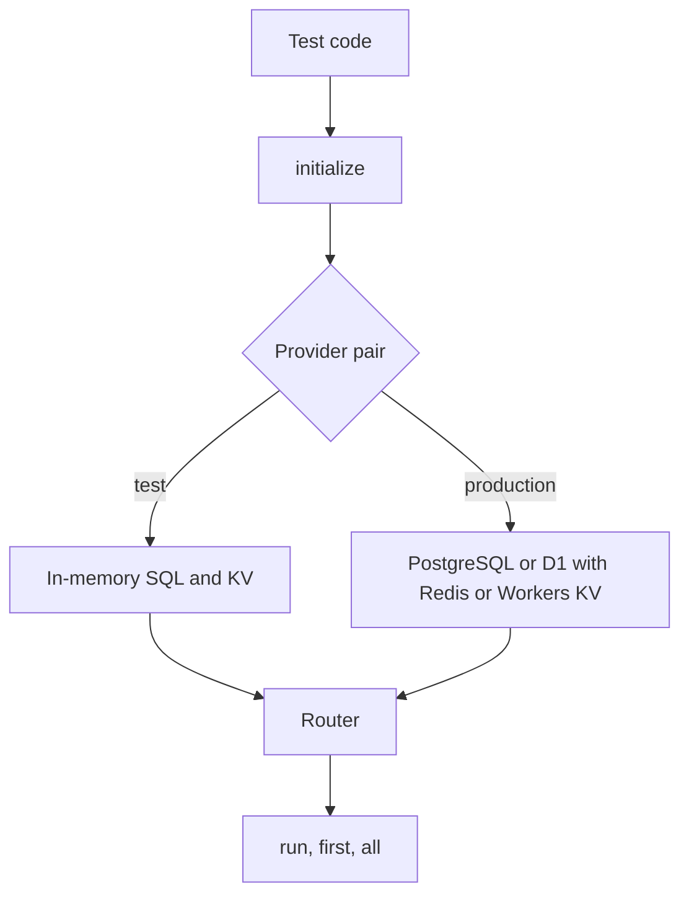

# Testing

This page covers the in-memory providers that CollegeDB ships for unit tests, integration tests, and local development. It also covers what the emulator does not model and how to move from it to production providers. It is for developers writing tests against routed code and for maintainers running the memory sandbox.

## In-Memory Providers

CollegeDB exports two in-memory providers from [`src/providers-memory.ts`](https://github.com/earth-app/CollegeDB/blob/master/src/providers-memory.ts). Both implement the `SQLDatabase` and `KVStorage` contracts and have no dependencies.

- `createInMemorySQLProvider()` returns an `InMemorySQLDatabase`, a SQLite-style SQL emulator.
- `createInMemoryKVProvider()` returns an `InMemoryKVStorage`, a key-value store with prefix listing and TTL.

Create a fresh pair for each test. Provider state lives in the instance, so a shared instance carries rows from one test into the next.

A test changes which providers it passes to `initialize`. The router code path stays the same.



The emulator covers routing and CRUD logic. It does not cover SQL dialect behavior, transactions, or latency. Check those against a real engine. The [Limitations](#limitations) section lists the gaps.

## Quick Start

Create the providers, initialize the router, and run a routed query.

```ts
import { createInMemoryKVProvider, createInMemorySQLProvider, initialize, run, first } from '@earth-app/collegedb';

const config = {
	kv: createInMemoryKVProvider(),
	shards: {
		'shard-1': createInMemorySQLProvider(),
		'shard-2': createInMemorySQLProvider(),
		'shard-3': createInMemorySQLProvider()
	},
	strategy: 'hash'
};

initialize(config);

await run('user-1', 'INSERT INTO users (id, name, email) VALUES (?, ?, ?)', ['user-1', 'Alice', 'alice@example.com']);

const user = await first<{ id: string; name: string }>('user-1', 'SELECT id, name FROM users WHERE id = ?', ['user-1']);
console.log(user); // { id: 'user-1', name: 'Alice' }
```

## Unit Testing

The Vitest file below initializes fresh providers before each test and calls `resetConfig` after each one.

<details>
<summary>Vitest unit test file</summary>

```ts
import { describe, it, expect, beforeEach, afterEach } from 'vitest';
import { createInMemoryKVProvider, createInMemorySQLProvider, initialize, resetConfig, run, first } from '@earth-app/collegedb';

describe('User Shard Routing', () => {
	beforeEach(() => {
		initialize({
			kv: createInMemoryKVProvider(),
			shards: {
				'shard-1': createInMemorySQLProvider(),
				'shard-2': createInMemorySQLProvider(),
				'shard-3': createInMemorySQLProvider()
			},
			strategy: 'hash'
		});
	});

	afterEach(() => {
		resetConfig();
	});

	it('should insert and retrieve a user', async () => {
		await run('user-1', 'INSERT INTO users (id, name, email) VALUES (?, ?, ?)', ['user-1', 'Alice', 'alice@example.com']);

		const user = await first<{ name: string }>('user-1', 'SELECT name FROM users WHERE id = ?', ['user-1']);

		expect(user?.name).toBe('Alice');
	});

	it('should distribute users across shards', async () => {
		for (let i = 0; i < 9; i++) {
			await run(`user-${i}`, 'INSERT INTO users (id, name) VALUES (?, ?)', [`user-${i}`, `User ${i}`]);
		}

		for (let i = 0; i < 9; i++) {
			const user = await first(`user-${i}`, 'SELECT id FROM users WHERE id = ?', [`user-${i}`]);
			expect(user).toBeDefined();
		}
	});

	it('should handle updates correctly', async () => {
		await run('user-1', 'INSERT INTO users (id, name) VALUES (?, ?)', ['user-1', 'Alice']);

		await run('user-1', 'UPDATE users SET name = ? WHERE id = ?', ['Alice Updated', 'user-1']);

		const user = await first<{ name: string }>('user-1', 'SELECT name FROM users WHERE id = ?', ['user-1']);

		expect(user?.name).toBe('Alice Updated');
	});
});
```

</details>

## Integration Testing

Lookup keys live in KV, so an integration test needs the mapper and the router to share one KV store. Pass the same instance to both.

```ts
import { createInMemoryKVProvider, createInMemorySQLProvider, initialize, KVShardMapper, resetConfig } from '@earth-app/collegedb';

resetConfig();

const kv = createInMemoryKVProvider();

initialize({
	kv,
	shards: {
		'shard-1': createInMemorySQLProvider(),
		'shard-2': createInMemorySQLProvider()
	},
	strategy: 'hash'
});

const mapper = new KVShardMapper(kv);

await mapper.addLookupKeys('user-123', ['email:alice@example.com', 'username:alice']);

const mapping = await mapper.getShardMapping('email:alice@example.com');
console.log(mapping?.shard);
```

To cover a second shard layout, call `resetConfig()` and run the same assertions against another `initialize` call.

## Performance Testing

The emulator runs in the same process as the test, so its timings measure router and emulator overhead. They do not measure database latency. For database latency, see [Benchmarks](benchmarks.md).

```ts
import { createInMemoryKVProvider, createInMemorySQLProvider, initialize, run } from '@earth-app/collegedb';

async function benchmarkInserts(iterations: number): Promise<number> {
	initialize({
		kv: createInMemoryKVProvider(),
		shards: {
			'shard-1': createInMemorySQLProvider(),
			'shard-2': createInMemorySQLProvider(),
			'shard-3': createInMemorySQLProvider()
		},
		strategy: 'hash'
	});

	const startTime = performance.now();

	for (let i = 0; i < iterations; i++) {
		const id = `perf-user-${i}`;
		await run(id, 'INSERT INTO users (id, name) VALUES (?, ?)', [id, `User ${i}`]);
	}

	return performance.now() - startTime;
}

const duration = await benchmarkInserts(1000);
console.log(`1000 inserts: ${duration.toFixed(2)}ms (${((1000 / duration) * 1000).toFixed(0)} ops/sec)`);
```

## Running the Memory Sandbox

From the repository root, `bun run test:memory` runs `sandbox/memory-example.ts`. The script times these workloads:

- Basic CRUD Operations
- In-Memory KV Storage
- round-robin strategy
- JOIN Queries

The script exercises the emulator only. Use it to catch regressions in routing code, not to compare against other providers.

## Supported Operations

The SQL emulator executes this subset of SQLite syntax:

- `CREATE TABLE [IF NOT EXISTS]` with column definitions, `PRIMARY KEY`, `AUTOINCREMENT`, and `DEFAULT`.
- `DROP TABLE`.
- `INSERT` with an explicit column list, `OR REPLACE`, `OR IGNORE`, `ON CONFLICT`, and `RETURNING`.
- `UPDATE` and `DELETE` with a compound `WHERE`: `AND`, `OR`, parentheses, `=`, `!=`, `<`, `>`, `<=`, `>=`, `LIKE`, `IS NULL`, and `IS NOT NULL`.
- `SELECT` with `*`, plain columns, `COUNT`, `MAX`, `MIN`, `SUM`, `AVG`, `COALESCE`, `AS` aliases, `ORDER BY`, `LIMIT`, and `OFFSET`.
- `PRAGMA page_count`, `PRAGMA page_size`, `PRAGMA table_info`, and `SELECT` from `sqlite_master`.

`CREATE INDEX`, `ATTACH`, and other statements the emulator does not model return success and do nothing.

The KV store supports:

- `get`, `put`, and `delete`.
- `list` with a prefix and cursor-based pagination.
- Expiration: `put(key, value, { expirationTtl })` in seconds. `set(key, value, { ttl })` takes the same unit.

## Limitations

- **SQL parsing**: The emulator pattern-matches the subset above. Complex expressions and syntax outside the list may fail or return wrong results. It does not evaluate full SQL expressions.
- **Joins**: Cross-table joins are not implemented. Join in application code, or read each table through the router and combine the results.
- **Transactions**: Transactions are not implemented, so rollback is not modelled. A test that depends on a failing batch rolling back earlier statements needs a real engine.
- **Indexes**: `CREATE INDEX` is accepted and ignored. Query plans and index-dependent behavior are not modelled.
- **INSERT ... SELECT**: The statement is not executed. Without a `VALUES` list, the emulator inserts one row from the bindings in schema order.
- **Missing tables**: A `SELECT` from a table that does not exist returns an empty result. Real engines raise an error.
- **Binary values**: The emulator has no BLOB handling.
- **Schema**: Columns come from `CREATE TABLE`. Without an explicit column list, bindings fill the columns in declaration order.

## Migrating to Production Providers

Replace the in-memory providers with production providers in the configuration. The routed API stays the same.

```ts
// Before (testing)
import { createInMemoryKVProvider, createInMemorySQLProvider } from '@earth-app/collegedb';

const config = {
	kv: createInMemoryKVProvider(),
	shards: { 'shard-1': createInMemorySQLProvider() }
};

// After (production)
import { createRedisKVProvider, createPostgreSQLProvider } from '@earth-app/collegedb';

const config = {
	kv: createRedisKVProvider(redisClient),
	shards: { 'shard-1': createPostgreSQLProvider(pgPool) }
};
```

Run the test suite against a real engine before shipping. The differences in [Limitations](#limitations) are where a test that passes on the emulator can fail on a production shard. For provider options, see [Providers](providers.md).
